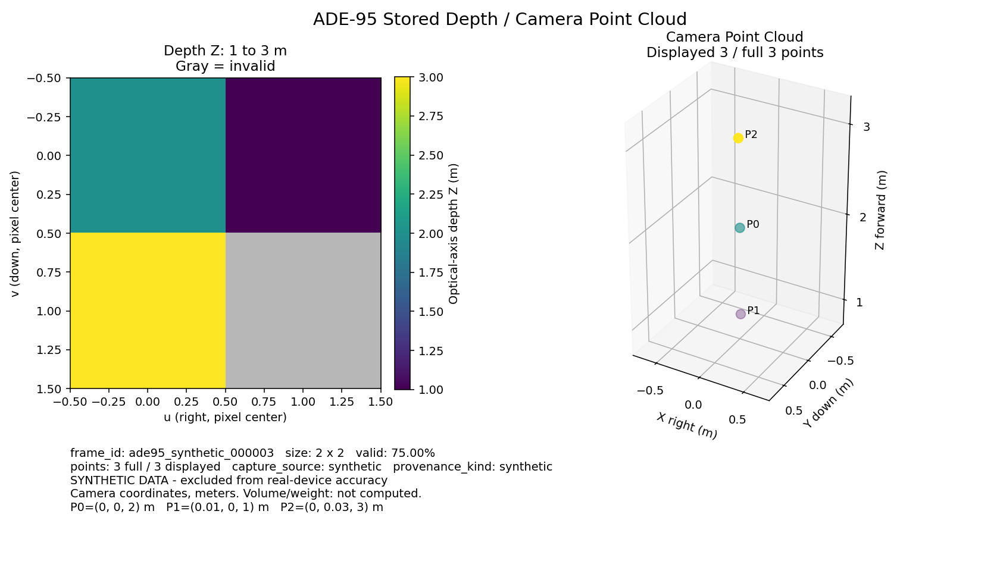

# ADE-95 저장 Depth·Point Cloud 독립 뷰어

카메라 없이 v1.0.0 저장 세션을 읽어 Depth와 카메라 좌표 3D 점군을 확인하는 PC 뷰어다. ADE-95 저장 입력 기반 구현은 팀장 검토 통과 상태이며, 이 문서는 다른 PC 설치 안내를 제공한다. 데이터 계약은 **v1.0.0 유지**다. 모바일 연결 가능성 조사와 다음 최소 실험은 문서 끝의 ADE-54 링크에 정리했다. 실제 연결 시험·기능 개발·부피/중량 검증과 공식 통합은 후속 범위다.

## Windows PowerShell: 공통 안내

아래 명령은 Python의 `>>>` 창이 아니라 **Windows PowerShell 터미널**에 입력한다. `Set-Location` 이후 명령은 프로젝트 루트(`README-viewer.md`, `requirements-viewer.txt`, `src`, `examples`가 있는 폴더)에서 실행한다. 경로에 공백이 있어도 실행되도록 실행 파일 앞에는 호출 연산자 `&`, 경로에는 따옴표를 쓴다.

가상환경 활성화는 필요 없다. `Activate.ps1`이 실행 정책 때문에 막혀도 `.venv\Scripts\python.exe`를 직접 호출한다. 사용자·시스템 실행 정책을 변경하지 않는다. 정상 기존 `.venv`는 재생성하거나 다른 PC로 복사하지 않는다.

필수 의존성은 [requirements-viewer.txt](requirements-viewer.txt)가 참조하는 [requirements.txt](requirements.txt)의 **NumPy 2.3.5**, 그리고 **Matplotlib 3.10.8**이다. [requirements-viewer.lock.txt](requirements-viewer.lock.txt)는 2026-10-08의 전체 설치 버전 기록이며, 아래 설치 입력은 `requirements-viewer.txt`다. Tk는 별도 Python GUI 구성 요소다.

## 현재 PC: 정상 기존 .venv 재사용

현재 작업 폴더에서는 설치를 반복하지 않고 다음 명령으로 확인·실행한다. `.venv`가 없거나 정상 환경이 아닌 새 복사본이면 다음의 새 PC 절차를 따른다.

```powershell
Set-Location -LiteralPath 'C:\study\injidong_contract_v1'
& '.\.venv\Scripts\python.exe' --version
& '.\.venv\Scripts\python.exe' -c "import tkinter; print('Tk', tkinter.TkVersion, 'Tcl', tkinter.TclVersion)"
& '.\.venv\Scripts\python.exe' -X utf8 'src/viewer.py' --help
$ade95Output = Join-Path 'outputs' ('viewer_gui_' + [guid]::NewGuid().ToString('N'))
& '.\.venv\Scripts\python.exe' -X utf8 'src/viewer.py' 'examples/viewer_multiframe' --output "$ade95Output"
$LASTEXITCODE  # 창을 닫아 PowerShell 프롬프트로 돌아온 직후 확인: 정상은 0
```

## 새 PC: 프로젝트 준비부터 설치·실행까지

### 1. 프로젝트 준비

Git이 설치되어 있고 저장소 접근 권한이 있다면, **PowerShell에서 저장할 상위 폴더로 이동한 뒤** 새 폴더에 clone한다. 아래 경로는 예시이므로 해당 PC의 경로로 바꾼다. 대상 폴더가 이미 있으면 다시 clone하지 말고 그 프로젝트 루트로 이동한다.

```powershell
Set-Location -LiteralPath 'C:\study'
git clone 'https://github.com/psy0635-ctrl/injidong-depth-viewer' 'injidong-depth-viewer'
Set-Location -LiteralPath '.\injidong-depth-viewer'
```

Git 없이 프로젝트 ZIP을 받았다면 새 폴더에 압축을 풀고, `README-viewer.md`가 있는 폴더로 `Set-Location -LiteralPath 'C:\받은 자료\injidong_ade95'`처럼 이동한다. GitHub 소스 ZIP은 최상위 폴더명이 다를 수 있다. 이전 제출 ZIP의 안내는 과거 버전일 수 있으므로 이 문서의 설치 절차를 따른다. `.venv`는 제공하지 않으며 이 PC에서 새로 만든다.

### 2. 설치된 Python 확인·선택

**프로젝트 루트의 PowerShell**에서 런처 경로와 설치 목록을 확인한다. 기본 `python`이나 인자 없는 `py`는 3.14 등 다른 버전일 수 있으므로 환경 생성에 그대로 쓰지 않는다.

```powershell
Get-Command py, python -ErrorAction SilentlyContinue | Select-Object Name, Source
py --list-paths
# 위 목록 옵션을 지원하지 않는 런처라면:
py -0p
```

목록에서 **3.11 또는 3.12 중 설치된 버전 하나**를 선택한다. 둘 다 없다면 Python 3.11/3.12의 Windows 설치본을 먼저 준비한다. 전체 설치 프로그램에서는 pip와 **tcl/tk and IDLE** 구성 요소를 포함하고, 필요하면 Python Launcher도 설치한다. Tcl/Tk와 pip가 없는 embeddable ZIP은 이 절차에 적합하지 않다. [공식 Windows 설치 문서](https://docs.python.org/3.11/using/windows.html#the-full-installer)를 참고한다.

### 3. 선택한 버전으로 새 .venv 생성

**프로젝트 루트**에서 실행한다. `.venv`가 이미 있으면 이 생성 절차를 중단하고 기존 환경의 버전을 확인한다. 기존 환경을 덮어쓰거나 삭제하지 않는다.

```powershell
if (Test-Path -LiteralPath '.venv') { throw '기존 .venv가 있습니다. 재생성하지 말고 기존 환경을 확인하세요.' }
# 3.11이 목록에 있다면 아래 두 줄을 실행:
py -3.11 --version
py -3.11 -m venv '.venv'
```

3.12를 선택한 경우에는 위 **두 줄 대신** `py -3.12 --version`, `py -3.12 -m venv '.venv'`를 실행한다. 출력이 선택한 3.11.x/3.12.x인지 확인한다. 런처가 없거나 목록의 배포판을 짧은 버전 옵션으로 찾지 못하면, 설치 목록/설치 위치에서 확인한 실행 파일의 절대 경로로 다음을 실행한다. 경로는 실제 값으로 바꾸며 세 가지 생성 방법 중 하나만 사용한다.

```powershell
& 'C:\실제 Python 설치 경로\python.exe' --version
& 'C:\실제 Python 설치 경로\python.exe' -m venv '.venv'
```

생성이 실패하면 이후 단계로 진행하지 않는다. 생성 성공 뒤 가상환경 자체의 버전도 확인한다.

```powershell
& '.\.venv\Scripts\python.exe' --version
& '.\.venv\Scripts\python.exe' -c "import sys; print(sys.executable); assert sys.version_info[:2] in ((3, 11), (3, 12)), 'Python 3.11/3.12 required'"
```

### 4. 뷰어 의존성 설치

**프로젝트 루트**에서 실행한다. 패키지 다운로드에는 인터넷 또는 해당 버전 wheel을 제공하는 패키지 저장소가 필요하다. 설치·검사 종료가 0인지 확인하고 실패하면 원인을 해결한 뒤 진행한다.

```powershell
& '.\.venv\Scripts\python.exe' -m pip install -r 'requirements-viewer.txt'
$LASTEXITCODE  # 0
& '.\.venv\Scripts\python.exe' -m pip check
$LASTEXITCODE  # 0, No broken requirements found
```

### 5. Tk import와 테스트 창을 각각 확인

Tk는 Python에서 GUI 창을 만드는 Tcl/Tk 구성 요소이며, `tkinter`는 그 Python 인터페이스다. Matplotlib의 TkAgg 뷰어에 필요하다. **Windows에서 `pip install tkinter`로 설치하는 패키지가 아니다.**

먼저 **프로젝트 루트**에서 import를 확인한다. 버전 출력은 모듈 로드 성공만 뜻하며 실제 창 표시 성공을 뜻하지 않는다.

```powershell
& '.\.venv\Scripts\python.exe' -c "import tkinter; print('Tk', tkinter.TkVersion, 'Tcl', tkinter.TclVersion)"
$LASTEXITCODE  # 0
```

다음 명령은 별도의 Tk 테스트 창을 연다. 창과 버튼이 보이는지 확인하고 창의 X로 닫은 뒤 종료 코드를 확인한다. [공식 tkinter 문서](https://docs.python.org/3.11/library/tkinter.html)에 안내된 테스트 방법이다.

```powershell
& '.\.venv\Scripts\python.exe' -m tkinter
$LASTEXITCODE  # 창을 닫은 후 0
```

`tkinter`/`_tkinter`가 없거나 Tcl/Tk 초기화 오류가 나면 **이 .venv를 만든 Python 설치**의 Tcl/Tk 구성 요소를 확인한다. Windows 전체 설치 프로그램의 Modify에서 **tcl/tk and IDLE**을 추가하거나 Repair로 설치 파일을 복구한 뒤 두 검사를 다시 실행한다. 다른 Python에 설치해도 현재 환경의 문제가 해결된다고 가정하지 않는다. GUI 데스크톱이 없는 실행 환경에서는 테스트 창·뷰어 조작을 확인할 수 없으며, 아래 `--headless` 검사만 수행한다.

### 6. 제공 다중 프레임 예제 실행

**프로젝트 루트**에서 아래를 입력한다. `examples/viewer_multiframe`은 `frames.jsonl`과 3개 프레임의 metadata·NPZ를 포함하는 합성 세션이다. 입력을 새로 만들거나 기존 출력 경로를 재사용할 필요가 없다.

```powershell
& '.\.venv\Scripts\python.exe' -X utf8 'src/viewer.py' --help
$ade95Output = Join-Path 'outputs' ('viewer_gui_' + [guid]::NewGuid().ToString('N'))
& '.\.venv\Scripts\python.exe' -X utf8 'src/viewer.py' 'examples/viewer_multiframe' --output "$ade95Output"
$LASTEXITCODE  # 창의 X로 닫은 직후: 정상 0, 처리 오류 1
```

예상 창 제목은 `ADE-95 Stored Depth / Camera Point Cloud`다. 왼쪽에 Depth와 m 범례, 오른쪽에 카메라 좌표 3D 점군, 아래에 `1 / 3`, frame_id·유효 비율·점 개수·합성 데이터 안내가 표시된다. 첫 프레임은 2×2, 유효 75%, 전체 3점이다. `Next`로 `2 / 3`, `3 / 3` 및 frame_id 변경을 확인하고 `Previous`로 돌아온다. `Save PNG + full NPZ` 또는 S를 누르면 화면/터미널의 `Saved:` 경로에 결과가 생긴다.

`--output`은 GUI에서는 저장 **부모 폴더**다. 저장할 때마다 `$ade95Output/frame_00000N_<시각 ns>/` 아래 `preview.png`, `points.npz`, `processing.json`, `viewer_export.json`을 만든다. 저장 버튼을 누르지 않으면 결과 폴더는 생성되지 않는다. 원본 입력 밖의 고유 출력 경로를 사용하고, 창을 닫은 뒤 프롬프트 복귀·오류 유무·`$LASTEXITCODE`를 확인한다. 옵션 오류는 종료 2다.

GUI 없는 환경의 최소 저장 검사도 **프로젝트 루트**에서 실행한다. `--headless`의 출력은 부모가 아니라 **새 결과 폴더 자체**이며, 이미 존재하거나 입력 안에 있으면 저장을 거부한다. 아래는 두 번째 프레임의 표시를 2점으로 제한하지만 전체 3점을 저장한다. 창 표시·프레임 이동 조작의 검증은 아니다.

```powershell
$ade95Result = Join-Path 'outputs' ('viewer_headless_' + [guid]::NewGuid().ToString('N'))
& '.\.venv\Scripts\python.exe' -X utf8 'src/viewer.py' 'examples/viewer_multiframe' --frame 2 --max-display-points 2 --headless --output "$ade95Result"
$LASTEXITCODE  # 0, Saved: 경로 출력
& '.\.venv\Scripts\python.exe' -X utf8 'scripts/verify_viewer_outputs.py' "$ade95Result" --session 'examples/viewer_multiframe'
$LASTEXITCODE  # 0, artifact_validation=passed, input_coordinate_validation=matched
```

## 조작과 저장

- `Previous / Next`, ←/→ 또는 P/N으로 프레임을 이동한다.
- 3D 영역에서 왼쪽 드래그로 회전, 오른쪽 드래그로 확대·축소한다. 도구 모음의 Home으로 기본 시점에 돌아간다.
- S 또는 `Save PNG + full NPZ` 버튼으로 새 결과 폴더에 저장한다.
- PNG는 **기본 재현 시점**으로 저장된다. GUI에서 회전한 현재 시점 그대로를 저장하지 않는다.
- 표시 점 수를 제한해도 `points.npz`에는 전체 점군을 저장한다. 원본 입력과 기존 결과를 덮어쓰지 않는다.

## 좌표·단위 설명 5줄

1. `depth_m[v,u]`는 광축 Z 방향 거리이며 float32 H×W, 단위는 m이다.
2. 유효 값은 finite & >0이며 무효 Depth는 0, 같은 크기의 `valid_mask`는 bool이다.
3. 픽셀 u는 오른쪽, v는 아래쪽이고 정수 인덱스를 픽셀 중심으로 사용한다.
4. 카메라 X는 오른쪽, Y는 아래쪽, Z는 전방이며 `X=(u-cx)Z/fx`, `Y=(v-cy)Z/fy`, `Z=depth_m[v,u]`다.
5. 점군은 float32 N×3 `points_m`, m 단위·유효 픽셀 행 순서이며 검증된 pose·sync 없이 world·다중 시점 결과를 만들지 않는다.

## Depth·3D 화면 예제

기존에 저장한 세 번째 합성 프레임의 화면을 재사용한다. 실기기 정확도 결과가 아니다.



## 저장 결과 검증

결과 폴더만 지정하는 기존 명령은 파일 구조·해시 검사를 수행한다. **입력 좌표 비교는 미실행**이며 `coordinates_verified=false`, `input_coordinate_validation.status=not_run`으로 표시한다. 감사 기록의 과거 `input_session` 절대 경로를 자동으로 신뢰하거나 frame_id 문자열에서 좌표를 추정하지 않는다.

입력 좌표까지 검증하려면 `--session`을 명시한다. 실제 입력의 같은 frame_id를 찾아 기존 로더·검증기·`point_cloud_camera`로 계산하고, 전체 점군의 dtype·shape·점 개수·행 순서·좌표 및 전체 입력 metadata를 비교한다. 동일한 float32 기준 함수로 저장·재계산하므로 **`numpy.array_equal`, 허용 오차 0(`rtol=0`, `atol_m=0`)**을 사용한다.

```powershell
# 기본 합성 프레임의 전체 입력 대조
& .\.venv\Scripts\python.exe -X utf8 scripts/verify_viewer_outputs.py outputs/ade95_final_synthetic --session examples/synthetic
$LASTEXITCODE

# 실제 사용자 저장 세 번째 프레임 2건의 전체 입력 대조
& .\.venv\Scripts\python.exe -X utf8 scripts/verify_viewer_outputs.py outputs/ade95_final_user_saves/frame_000003_1791460557654228600 --session examples/viewer_multiframe
$LASTEXITCODE
& .\.venv\Scripts\python.exe -X utf8 scripts/verify_viewer_outputs.py outputs/ade95_final_user_saves/frame_000003_1791460742554215400 --session examples/viewer_multiframe
$LASTEXITCODE

# 파일 무결성만 검사: 좌표 검증 완료를 뜻하지 않음
& .\.venv\Scripts\python.exe -X utf8 scripts/verify_viewer_outputs.py outputs/ade95_final_synthetic
$LASTEXITCODE
```

ZIP에는 원래 `outputs/demo_gui` 대신 바이트 동일한 `outputs/ade95_final_user_saves` 복사본이 포함된다. 로컬 원래 결과를 검사할 때는 결과 경로만 `outputs/demo_gui/...`로 바꾸고 같은 `--session`을 사용한다.

명시한 입력이 없거나 frame_id가 없고, metadata·점군이 다르면 종료 1과 원인을 반환한다. `artifact_validation`은 파일 무결성, `input_coordinate_validation`은 실제 입력 대조 결과다. 전체 성공이어도 입력 미지정 시 좌표 검증 성공으로 해석하지 않는다. 인자 오류는 종료 2다. `--original-inventory`는 유지하며 원래 로컬 작업 폴더용이다. 새 ZIP만 풀었을 때는 제출물 밖 파일을 참조하는 목록을 지정하지 않는다.

## 배포 스키마와 기록 구분

버전 키는 `schema_version="1.0.0"`이다. 시간 객체는 필수이고 시각을 모르면 `{"ns":null,"clock_domain":null,"origin":null}`을 유지한다. `pose`·`imu`는 없으면 null이다. 원본 문서 요약의 `version`·`capture_time=null` 표현과 차이가 있지만 배포 스키마를 따르며 공통 규격을 변경하지 않았다.

2026-10-08 검토의 `previous_review`와 ADE-66·67 로그·패키지 설명은 과거 기록이다. 이번 설치 안내 보완에서는 GUI 코드를 변경하지 않았다. 현재 PC의 기존 환경 재사용과 별도 임시 venv 설치 검증, 자동 Tk 이벤트 검사 결과는 [상세 사용·검증 문서의 2026-10-11 기록](docs/ADE-95-독립뷰어-사용검증.md)에 구분해 적었다. 다른 물리 PC·Python 3.12 및 사람의 직접 화면 확인·조작은 이번 검증 범위 밖이다.

자세한 오류 정책·결과 구조·1분 시연 대본은 [상세 사용·검증 문서](docs/ADE-95-독립뷰어-사용검증.md)를 참고한다.

후속 ADE-54의 직접 Android USB·PC 경유 결과 표시 비교와 최소 실험 계획은 [모바일 Depth 연결 조사](docs/ADE-54-모바일-Depth-연결-조사-20261011.md)를 참고한다. 설치·저장 예제 성공과 실제 휴대폰 연결 검증은 구분한다.
