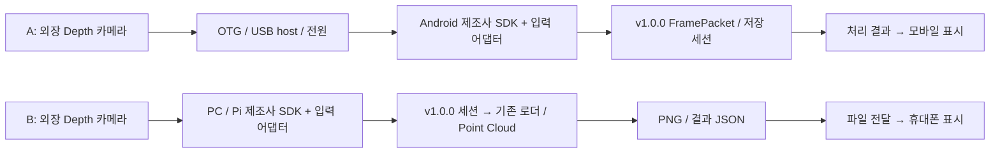

# ADE-54 모바일 Depth 연결 가능성 조사와 다음 최소 실험

조사일: **2026-10-11, Asia/Seoul**. 대상 리뷰: **2026-10-12**. 모바일 입력 검증 책임: 박수용. 최종 연결 방식·규격 변경 검토: 강석현.

## 1. 조사 결론과 범위

**우선 실험 후보는 B: D405 → 기존 PC 계열 처리 환경 → 휴대폰에 저장 결과 표시**다. 도형준의 실제 Depth 저장 보고와 기존 v1.0.0 로더·뷰어를 활용할 수 있어, 카메라 취득·규격 검증·화면 전달의 실패 지점을 나누기 쉽다. 이 추천은 다음 실험 순서에 대한 판단이며 최종 연결 방식 확정이 아니다. Raspberry Pi 보고를 현재 Windows PC에서의 D405 취득 성공으로 확대하지 않는다.

**A: 카메라 → Android 직접 USB**도 공식 SDK 근거가 있는 조사 후보다. 다만 정확한 현물 모델/firmware, 휴대폰 모델·Android·USB host·속도·전원·CPU ABI가 없으므로 **모든 실제 휴대폰 조합은 미검증**이다. 이번 주 실제 연결 성공은 필수 완료 기준이 아니다. PC Python SDK 지원·PC에서 만든 결과의 휴대폰 표시를 Android USB Depth 취득 성공으로 보고하지 않는다.

이번 수행은 문서·지원표·SDK 소스의 읽기 조사와 문서 작성이다. Android 앱·연결 기능·서버 구현, 장치 제어, firmware 변경, SDK/드라이버 설치, 휴대폰 설정 변경은 수행하지 않았다. FastAPI·서버·새 앱을 필수 선행 과제로 추가하지 않는다.

앞 단계의 설치 검증은 같은 Windows PC에서 기존 `.venv`와 분리된 새 venv를 사용한 **저장 예제 실행 검증**이다. 별도 물리 PC·Python 3.12·사람의 직접 GUI 조작은 미검증이며, 이를 실제 카메라/휴대폰 연결 근거에 포함하지 않는다. 설치 안내는 [README-viewer.md](../README-viewer.md), 당시 검증 범위는 [ADE-95 사용·검증 문서](ADE-95-독립뷰어-사용검증.md)에 있다.

## 2. 프로젝트 기록과 실제로 확인한 범위

Linear 연결을 통해 아래 본문·댓글과 최신 규격을 **이번에 재조회했다**. 모두 프로젝트 관계자의 요구·보고 기록이며 Codex의 직접 장비 시험 결과가 아니다. 이슈 본문의 과거 Git 미설정/승인 대기 표현은 당시 이력이다.

| 출처 | 최신 수정 시각(KST) | 이번 확인한 내용 |
|---|---|---|
| [ADE-54](https://linear.app/ade0033/issue/ADE-54) | 2026-10-10 13:51:57 | 박수용 모바일 입력 책임, 10/12 가능성·제약·근거·최소 실험 제출. A/B 비교, 직접 연결 성공은 이번 주 필수 아님 |
| [ADE-63](https://linear.app/ade0033/issue/ADE-63) | 2026-10-10 14:13:08 | ADE-66/67/95 리뷰 통과 보고. 정확한 서로 다른 제조사 3종 목록·공식 원격 저장소 미확정 |
| [ADE-64](https://linear.app/ade0033/issue/ADE-64) | 2026-10-10 18:22:24 | 도형준 공식 SDK 설치·실제 수집·원본/메타데이터 제공 책임 |
| ADE-64의 도형준 댓글 | 작성 2026-10-10 18:22:19 | D405, firmware 5.15.1.55, USB 3.2, Raspberry Pi ARM64/Debian 13, librealsense 2.54.2/pyrealsense2. 640×480/30 FPS/Z16, Depth 10프레임 저장 보고 |
| [ADE-93](https://linear.app/ade0033/issue/ADE-93) | 2026-10-10 14:13:10 | 공용 API 기본형의 현재 backend는 synthetic 1개. 제조사 실제 USB backend 완료나 Android 지원 완료를 주장하지 않음 |
| [최신 공통 규격](https://linear.app/ade0033/document/인지동-공통-데이터인터페이스-규격-v100-a3b36c5035c8) | 2026-10-10 13:50:43 | 표현 정정, schema_version 1.0.0·시간 객체 필드별 null·담당 경계 유지. 기술 계약 변경 없음 |

ADE-54/63/64/93 댓글 조회는 모두 다음 페이지 없음이었다. ADE-64 댓글 1건, 나머지 0건. 도형준 댓글은 Viewer/Python 스트림 성공 외에 `rs-enumerate-devices`의 일부 `/dev/video*` 열기 오류와 segmentation fault도 보고하며 원인을 미확정으로 남긴다. 조사자가 이를 해결하거나 재현하지 않았다.

| 장비/자료 | 확인 상태 | 미확인 정보 |
|---|---|---|
| Orbbec Astra Mini | 과거 사용자 전달 장비명. 로컬 README·규격 정리본과 ADE-54 이력에 존재 | 현물 라벨·시리얼·세부 suffix·firmware·수량·실제 USB 인터페이스 |
| Orbbec Astra Mini Pro | 같은 과거 전달 기록 | 현물/firmware가 OpenNI 1.x인지 UVC 2.x인지, Mini S Pro 등과의 구분 |
| Intel RealSense D405 | ADE-64의 팀원 실제 장비 보고로 모델·환경 확인 | 직접 현물 확인·원본 파일 검토는 미수행. 연결 PC/휴대폰 조합별 지원·재현성 |
| 서로 다른 제조사 3종 | ADE-63/93의 목표 | 전체 현물 목록 미확정. 위 Orbbec 두 모델을 서로 다른 제조사 두 종으로 세지 않음 |
| capture10.py / depth10.npz / metadata.txt | 댓글의 산출물 이름만 확인, 댓글 첨부 없음 | 파일·해시·실행 코드·원시 배열 및 상세 metadata 확보, v1.0.0 세션 적합성 |
| 대상 휴대폰/부속 | 제공되지 않음 | 모델·Android/ROM·ABI·USB host/속도·전력·케이블·OTG 어댑터·허브 |

현재 저장소에는 별도의 실제 현물 inventory나 위 D405 산출물이 발견되지 않았다. 기존 문서 루트의 `docs/reviews/ade-54-input-design.md`도 읽었다. 그 문서의 manifest.json/.npy·schema_version 1.0 등은 과거 **제안**이며, 이번 조사에서는 현재 저장소의 [frame.schema.json](../schemas/frame.schema.json)과 v1.0.0을 적용한다. 기존 모바일 설계는 PC 재생과 Android 어댑터를 분리하고 USB·전원·권한·보정·시각을 확인한 후 연결하도록 제안했다. 기존 `/depth_feed`의 색 입힌 JPEG는 표시 자료이며 수치 Depth 원본으로 사용할 수 없다는 기록도 유지한다.

## 3. 연결 조건을 읽는 방법

- **USB host/OTG:** 휴대폰이 카메라를 관리하는 쪽이 되어 장치를 검색하고 통신하는 기능이다. USB-C 단자가 있다는 사실만으로 host·USB 3 속도·충분한 전원이 보장되지 않는다. Android 자체의 USB host API 지원과 해당 휴대폰의 실제 지원도 다르다. [A1](https://developer.android.com/develop/connectivity/usb/host)
- **SDK:** 카메라의 전용 프로토콜을 열고 수치 Depth·보정·시각을 읽는 제조사 라이브러리다. 일반 USB 웹캠 앱에서 Color가 보이는 것만으로 Depth 취득을 확인할 수 없다. PC용 Python wrapper와 Android용 Java/JNI/AAR 또는 JAR·`.so`는 다른 배포물이다.
- **전원:** host는 USB 버스 전원을 공급한다. 카메라 소비전력만큼 휴대폰이 안정적으로 공급하는지 별도 확인해야 한다. 외부 전원 허브는 공급 부족·재연결 증상의 다음 확인 수단이며 모든 조합에서 필수라고 확정하지 않는다. 허브 자체도 host 역할·데이터 속도·전원 연결을 지원해야 한다.
- **CPU ABI:** 네이티브 `.so`가 휴대폰에서 실행될 수 있는 기계어 형식이다. `arm64-v8a`/`armeabi-v7a`와 실제 폰·APK에 포함된 라이브러리가 일치해야 한다. Linux ARM64 Python 성공은 Android ARM64 성공을 뜻하지 않는다.
- **권한:** USB 장치별 사용자 접근 허용이 필요하다. 앱의 `android.hardware.usb.host` 선언·장치 필터·권한 승인 흐름을 확인한다. 선택한 샘플이 CAMERA 권한을 요구하면 Android 버전별 요구도 함께 확인한다. [A1](https://developer.android.com/develop/connectivity/usb/host)

## 4. 후보별 연결 조사표

판정의 **가능**은 조사한 공식 지원 범위와 필수 조건이 확인된 경우이며 실제 시험 성공과 다르다. **불가**는 명시적 미지원 등 해당 조건의 근거가 있을 때만 사용한다. **미검증**은 모델/환경/지원 조건/시험 증거가 부족한 경우다. 아래 A/B 행은 실제 프로젝트 조합의 판정이며, 공식 SDK 지원 여부는 별도로 적는다.

| 카메라 | 연결 경로 | 공식 지원 근거 | USB·전원·SDK 조건 | 가능·불가·미검증 | 판단 이유 | 필요한 추가 정보 |
|---|---|---|---|---|---|---|
| Astra Mini (전달명) | A 직접 Android | OpenNI 공식 목록 `Astra Mini(S)`, Android 배포 존재 [O1](https://www.orbbec.com/developers/openni-sdk/)·[O2](https://github.com/orbbec/OpenNI_SDK/blob/main/Doc/English/0100_Installation.md) | OpenNI Android, USB 2 host/OTG, ARMv7/ARM64. 정확한 전력·케이블·firmware는 현물별 확인 | **미검증** | 계열 지원 근거는 있으나 전달명만으로 세부 모델/휴대폰 필수 조건 확인 불가 | 현물 라벨·FW·폰·ABI·OTG·전력 |
| Astra Mini (전달명) | B PC → 결과 표시 | OpenNI Windows/Linux 지원 [O1]·[O2] | PC용 OpenNI 및 기존 파일 입력. 공식 PC Python binding은 이번 자료로 확정하지 않음 | **미검증** | SDK 입력 어댑터와 실제 세션·휴대폰 전달 시험 없음 | PC OS/SDK, 수치 원본·scale·보정, 결과 전달 수단 |
| Astra Mini Pro | A 직접 Android | Android wrapper **v1.10.3**, 최소 FW **1007**, Android 13 시험 명시 [O3](https://github.com/orbbec/OrbbecSDK-Android-Wrapper/releases/tag/v1.10.3); OpenNI 경로도 [O1] | FW 1.x/OpenNI와 일치하는 v1 SDK, OTG·USB 2 데이터/전원, JNI `.so`와 폰 ABI 일치 | **미검증** | 공식 지원 후보이나 현물 FW·폰·전력 미확인. 최신 PC v2 지원을 Android로 확대 불가 | exact model/FW, 폰·Android·ABI, 호스트 공급전력 |
| Astra Mini Pro **FW 1.x/OpenNI** | A에서 **Android wrapper v2-main 선택 조건** | v2-main 지원표가 Mini Pro를 `not supported`로 명시 [O4](https://github.com/orbbec/OrbbecSDK-Android-Wrapper/blob/v2-main/README.md) | 해당 v2 wrapper 조합은 지원 조건에 맞지 않음 | **불가: 해당 SDK 선택에 한정** | 카메라의 모든 Android 연결이 불가하다는 뜻은 아님. v1/OpenNI 경로는 별도 후보 | 현물 FW 확인 후 v1 SDK 후보 검토; 신규 FW Android 지원은 제조사 확인 |
| Astra Mini Pro | B PC → 결과 표시 | PC SDK v1·Python v1의 FW 1007 목록 [O5](https://github.com/orbbec/OrbbecSDK/blob/main/README.md)·[O6](https://github.com/orbbec/pyorbbecsdk/blob/main/README.md); PC v2/FW 2.0.03 지원 [O7](https://github.com/orbbec/OrbbecSDK_v2/releases/tag/v2.10.6) | 현물의 1.x/OpenNI 또는 2.x/UVC와 SDK branch를 맞춤. USB 2, 호스트 전력·모듈 케이블 확인 | **미검증** | PC 지원 근거는 있으나 현물 FW·실제 세션·폰 표시 시험 없음 | FW/프로토콜, PC SDK/Python 배포 호환, 실제 세션 |
| D405 (팀원 보고) | A 직접 Android | SDK 2.54.2 Android wrapper·USB3 OTG 문서 [R1](https://github.com/realsenseai/librealsense/blob/v2.54.2/doc/android.md), SDK 출시 플랫폼 표 [R2](https://github.com/realsenseai/librealsense/releases/tag/v2.54.2) | Android AAR/Java/JNI, USB3 OTG 및 충분한 전력. SDK2.54.2/FW5.15.1.55 조합은 폰에서 미시험 | **미검증** | 공식 Android 경로는 있지만 문서가 Android 검증 제한을 명시. Raspberry Pi 캡처 보고는 직접 Android 근거 아님 | 폰 모델·ROM/OS·ABI·USB3 host·전력, 대응 AAR |
| D405 (팀원 보고) | B PC → 결과 표시 | D405 공식 사양 [R3](https://www.intel.com/content/www/us/en/products/sku/229218/intel-realsense-depth-camera-d405/specifications.html), PC/Python SDK2.54.2 지원 [R2] | 기존 Raspberry Pi 보고 환경부터 재현. Windows는 별도 확인. USB3 데이터 케이블/PC, 파일 결과 전달 | **미검증** | 카메라 → Pi 취득은 팀원 성공 보고. 세션 규격·전달·폰 표시까지는 미확인 | 원본 3파일·정확한 metadata·해시, 사용 PC·전달 수단 |
| 미확정 나머지 제조사/현물 | A / B | 모델 미확정으로 공식 지원표 대조 불가 | 조건 미확인 | **미검증** | 지원 언급을 못 찾은 것을 불가로 판정하지 않음 | vendor/model/serial/FW/SDK/profile/수량 |

`Astra Mini`, `Astra Mini S`, `Astra Mini Pro`, `Astra Mini S Pro`, `Astra 2`는 이름이 비슷해도 동일 모델로 취급하지 않는다. v1 표의 `1007` 표기와 현물 화면의 점 구분 firmware 문자열도 제조사 근거 없이 동일시하지 않는다.

## 5. SDK 버전·하드웨어 조건의 세부 근거

### Orbbec Astra Mini / Mini Pro

OpenNI 현재 다운로드 페이지는 **2.3.0.86**와 Astra Mini(S)/Mini Pro를 명시한다. 페이지의 플랫폼 요구는 Windows 10+/USB3, Ubuntu 14.04+/USB2, Android 4.4.2+/USB2 OTG다. 저장소 설치 문서에는 Windows 7/8/10·USB2 등 더 오래된 조건도 남아 있다. **현재 배포 페이지와 과거 설치 문서를 구분**하며 Windows 목록 차이로 카메라의 USB2 자체가 불가하다고 해석하지 않는다. Android ARMv7a/ARM64v8a 및 JAR·네이티브 라이브러리 구성은 설치 문서에 있다. 정확한 다운로드 패키지·현물 FW의 호환은 다음 확인이다. [O1]·[O2]

Mini Pro에 대해 PC SDK v1은 FW 1.x/OpenNI, PC SDK v2는 FW 2.x/UVC를 구분한다. 조회한 PC SDK v2 **v2.10.6**은 FW **2.0.03**을 명시한다. 반면 Android wrapper **v2.0.6**은 SDK core v2.7.6 기반이며, 조회한 v2-main 표는 Mini Pro 미지원이다. 최신 PC 지원표·Python wrapper 표·Android wrapper 표가 서로 같은 시점/버전이라는 가정을 하지 않는다. **FW2.x Mini Pro의 Android 지원은 제조사 확인 전 미검증**, FW1.x를 v2 wrapper로 여는 선택은 지원표상 제외한다. firmware 업데이트로 이 차이를 해결하는 작업은 이번 계획에 포함하지 않는다. [O4]·[O5]·[O7]·[O8](https://github.com/orbbec/OrbbecSDK-Android-Wrapper/releases/tag/v2.0.6)

Android v1.10.3은 Android 13 테스트 기록이 있고, build.gradle은 `minSdk 24`, `arm64-v8a`/`armeabi-v7a`를 지정한다. OpenNI의 Android 4.4.2 조건을 이 wrapper의 최소 조건으로 복사하지 않는다. PC의 `pyorbbecsdk` main은 SDK v1, 다른 branch는 v2 경로이며 Mini Pro/FW1007 목록을 확인했다. Astra Mini plain 모델의 공식 Python 지원을 이 목록에서 확정하지 않았다. [O3]·[O6]·[O9](https://github.com/orbbec/OrbbecSDK-Android-Wrapper/blob/main/obsensor_jni/build.gradle)

Mini Pro 공식 제품 페이지는 USB2 Type-A 데이터/전원과 평균 **2.4W 미만**을 제시한다. 과거 Datasheet v1.0은 모듈 **DF13·5V**, 평균 **2.0W 미만/피크 2.5W**, 기본 케이블 사용·맞춤 연장 1~1.5m 권고를 제시한다. 이 차이는 제품/문서 판본 확인 사항이며, 임의로 하나를 현물의 확정 전력값으로 쓰지 않는다. 모듈 단자와 제공 USB 케이블의 호스트 쪽 단자도 구분한다. 이 Pro 사양을 plain Mini에 복사하지 않는다. 외부 전원 허브 필요성은 폰 공급 전력·현물 피크·실제 끊김 시험 후 판단한다. [O10](https://www.orbbec.com/products/structured-light-camera/astra-mini-pro-series/)·[O11](https://www.orbbec.com/staging/wp-content/uploads/2023/04/ORBBEC_Datasheet_Astra-Mini-Pro.pdf)

### Intel RealSense D405

보고 환경은 **FW5.15.1.55 / SDK2.54.2 / Raspberry Pi ARM64 / Debian13**이다. 공식 SDK2.54.2 출시표는 Windows10/11, Ubuntu18.04/20.04/22.04와 Python3.7~3.11, D400 권장 FW5.15.1.0 이상을 적는다. 보고 FW는 그 수치상 범위 안이지만 **D405·해당 빌드·Debian13·Android의 정확한 조합에 대한 공식 검증 근거는 별도 확인**이다. Debian13은 해당 출시표의 검증 OS에 없다. 팀원 성공 보고를 공식 검증 OS 추가로 해석하지 않는다. [R2]

2.54.2 Android 설명은 Android4.4+/OTG·USB3 OTG 케이블·AAR/JNI 예제를 안내하지만 **Android 명시 검증은 하지 않았고 작동을 기대한다는 제한**도 적는다. 출시표는 Android7~11, Android10에서 일부 ROM의 장치 인식 문제를 명시한다. 현재 master 문서는 Android6+로 달라졌고, 조회 시 최신 릴리스 **2.58.4 beta**는 Android7~14에 `compilable, but not validated`를 붙인다. 최신 표의 Other D400 USB 권장 FW는 5.17.0.10 이상으로 과거 보고 조합과 다르다. **현재 beta로 업그레이드해야 한다고 결론 내리지 않으며**, 다음 실험은 보고 버전의 재현·AAR 호환부터 확인한다. [R1]·[R2]·[R4](https://github.com/realsenseai/librealsense/blob/master/doc/android.md)·[R5](https://github.com/realsenseai/librealsense/releases/tag/v2.58.4)

D405 공식 사양은 USB3.1 Gen1과 **1.55W**를 명시한다. 보고의 USB3.2 연결명은 host 측 정보이며 카메라 사양 변경을 뜻하지 않는다. USB3 데이터가 가능한 OTG·케이블·허브를 준비하고 실제 협상 속도를 기록한다. 충전 전용 케이블이나 USB2로 제한된 폰 포트로 동일 profile이 가능한지는 별도 시험이다. 소비전력 평균값만으로 폰의 피크 공급·안정성을 보장하지 않는다. [R3]

Android는 `librealsense.aar`의 권한 처리·JNI 경로다. 해당 버전 빌드 문서는 4개 ABI 구성을 설명하지만 다운로드 AAR 내부의 정확한 ABI를 이번에는 검사하지 않았다. 폰 ABI와 AAR의 `jni/<abi>/*.so`를 대조한다. PC `pyrealsense2`의 ARM64 동작으로 Android 네이티브 호환을 대신하지 않는다. [R1]·[R6](https://github.com/realsenseai/librealsense/blob/v2.54.2/wrappers/android/readme.md)

## 6. 원본 Depth·scale·Depth intrinsics·timestamp의 취득 경계

아래는 공식 API를 읽어 확인한 **취득 경로**이며 실행·변환 코드 구현 결과가 아니다. 해당 모델/버전에서 필드가 실제 반환되는지는 다음 실험에서 확인한다.

| SDK 경로 | 원본 Depth·scale | Depth intrinsics | timestamp와 남은 확인 |
|---|---|---|---|
| Astra Mini 계열 OpenNI | Depth stream의 `readFrame()` → `VideoFrameRef.getData()`와 video mode/pixel format 확인. 단위는 활성 pixel format·제조사 속성 근거를 확보하여 결정, dtype만으로 mm 추정 금지 | `CoordinateConverter::convertDepthToWorld`는 보정 좌표 변환 API. 이것만으로 v1.0.0에 필요한 fx/fy/cx/cy·정류 상태를 확보했다고 판단하지 않음. 정확한 모델의 calibration/property 조회 방법 추가 확인 | `getTimestamp()`는 임의 기준점부터의 microseconds. ns 변환과 clock origin 기록 필요; 촬영 시각으로 유효한지 확인. 포맷·무효 sentinel·모델별 내참수는 미검증 [O12](https://github.com/orbbec/OpenNI_SDK/blob/main/Doc/English/Include/OpenNI.h) |
| Astra Mini Pro Android wrapper v1 | `Frame.getData()`로 수치 버퍼, `DepthFrame.getValueScale()`은 **mm/step**. m 변환 계수는 실제 값/1000 | 실제 Depth `VideoStreamProfile.getIntrinsic()`·`getDistortion()` | `getTimeStamp()`는 장치 ms, `getTimeStampUs()`는 장치 us, system timestamp는 별도. 장치의 유효 반환·원점/clock domain을 확인하여 capture/host 시각 분리. raw stride·format·invalid 정책도 확인 [O13](https://github.com/orbbec/OrbbecSDK-Android-Wrapper/blob/main/obsensor_jni/src/main/java/com/orbbec/obsensor/DepthFrame.java)·[O14](https://github.com/orbbec/OrbbecSDK-Android-Wrapper/blob/main/obsensor_jni/src/main/java/com/orbbec/obsensor/VideoStreamProfile.java)·[O15](https://github.com/orbbec/OrbbecSDK-Android-Wrapper/blob/main/obsensor_jni/src/main/java/com/orbbec/obsensor/Frame.java) |
| D405 PC Python | Depth frame `get_data()`로 Z16 수치를 취득하고 실제 depth sensor `get_depth_scale()`(m/raw unit)을 기록 | `depth_frame.profile.as_video_stream_profile().get_intrinsics()`. 선택한 Depth profile의 해상도·왜곡 모델/계수도 기록 | `get_timestamp()`와 `get_frame_timestamp_domain()`을 함께 기록. ms→ns 변환은 원래 정밀도·clock origin을 유지. 댓글의 약식 scale/intrinsics를 코드 상수로 사용하지 않음 [R7](https://github.com/realsenseai/librealsense/blob/v2.54.2/wrappers/python/pyrs_frame.cpp)·[R8](https://github.com/realsenseai/librealsense/blob/v2.54.2/wrappers/python/pyrs_sensor.cpp) |
| D405 Android Java/JNI | `Frame.getData(byte[])`, `DepthFrame.getUnits()` API 존재. raw의 byte order/stride·단위를 선택 버전의 native 구현과 대조 | `VideoStreamProfile.getIntrinsic()` | `Frame.getTimestamp()`와 `getTimestampDomain()`. capture 예제의 Color/색 입힌 이미지 대신 수치 Depth 취득을 확인. 실기기 반환값·ABI·촬영 시각은 미검증 [R9](https://github.com/realsenseai/librealsense/blob/v2.54.2/wrappers/android/librealsense/src/main/java/com/intel/realsense/librealsense/DepthFrame.java)·[R10](https://github.com/realsenseai/librealsense/blob/v2.54.2/wrappers/android/librealsense/src/main/java/com/intel/realsense/librealsense/VideoStreamProfile.java)·[R11](https://github.com/realsenseai/librealsense/blob/v2.54.2/wrappers/android/librealsense/src/main/java/com/intel/realsense/librealsense/Frame.java) |

## 7. A/B 연결 구조·입출력과 구현 부담

SDK 경계의 입력은 **수치 원본·활성 profile·scale·보정·센서 시각**이고 출력은 v1.0.0 FramePacket/세션이다. 처리 경계는 Depth·mask·내참수를 받아 카메라 좌표 Point Cloud와 처리 결과를 만든다. 표시 경계는 PNG·결과 JSON을 받는다. Android SDK 객체나 실측 label은 공통 코어 입력에 넣지 않는다. 그림의 Android 어댑터/모바일 처리는 후속 후보이며 구현 완료를 뜻하지 않는다.

| 비교 | A 직접 Android USB | B PC 처리 → 휴대폰 결과 표시 |
|---|---|---|
| 구현 부담 | Android 전용 SDK·권한·JNI/ABI·앱 생명주기·장치 분리/자원 해제 확인. 공통 계약 어댑터 필요 | PC SDK 입력 확인 후 기존 저장 로더/뷰어 재사용. 첫 실험은 PNG/JSON 파일 전달로 가능 |
| 필수 장비 | exact camera/FW, host 가능한 폰, 데이터 OTG/케이블, 필요시 외부 전원 허브 | camera/케이블, 적합한 PC 또는 보고된 Pi, 결과를 열 수 있는 폰·기존 파일 전달 수단 |
| 확인된 근거 | OpenNI/Orbbec v1/RealSense Android 공식 경로. 특정 폰 조합은 미검증 | D405 → Pi 실제 10프레임 팀원 보고, 기존 저장 예제 로더·뷰어. 전체 B 경로는 미검증 |
| 남은 실험 | 장치 인식 → 실제 수치 Depth → scale/보정/시각 → 규격 검증·저장 → 종료 | 원본 수령/검토 → PC 규격 검증/처리 → 실제 폰 표시. 실시간 요구는 팀장 확인 |
| 제약 | 폰 OS/ROM·ABI·속도·전력·SDK 지원표 버전의 영향을 받음 | PC/Pi 의존. 결과 표시 지연·전달 경로 필요. 휴대폰이 직접 Depth를 취득하지 않음 |
| 성공을 보고할 이름 | “카메라→Android 수치 Depth 취득 및 계약 검증”을 단계별 기록 | “PC/Pi 취득·처리 결과의 휴대폰 표시”. A 성공으로 보고 금지 |

**우선 B의 저장 결과 전달 실험을 추천한다.** 먼저 도형준의 원본 3파일을 받고 정확한 metadata와 해시를 확인한다. 파일이 v1.0.0 세션이 아니면 누락 필드와 변환 경계를 기록하고 후속 어댑터 작업으로 넘긴다. 새 기능을 이번에 구현하지 않는다. phone 정보 확보 후 기존 파일 전달·이미지 열기로 첫 표시 실험을 할 수 있다. 실시간 통신·새 Android UI·서버가 필수라는 전제를 두지 않는다. 동시에 A의 지원표/폰 조건 확인은 진행할 수 있다.

## 8. v1.0.0 규격 유지 사항

1. `depth_m`: float32 H×W, m의 **카메라 광축 Z 거리**. 원시 dtype/단위·활성 profile·SDK scale을 보존하고 실제 scale로 변환한다. 보정이 광축 Z를 보장하는지 확인한다.
2. `valid_mask`: bool H×W. 원본 측정 무효값 규칙과 finite & >0를 확인하고 무효 Depth는 0으로 유지한다. 표시용 보간/색칠을 측정 유효값으로 승격하지 않는다.
3. Depth profile의 실제 width/height/fx/fy/cx/cy·왜곡/정류·calibration 근거를 사용한다. Color 내참수나 댓글의 약식 숫자를 Depth 확정 상수로 쓰지 않는다.
4. 원본 `capture_time`·`capture_source`·`provenance`·raw 해시를 보존한다. PC 수신/재생 시각은 별도 객체다. clock domain/원점을 모르면 임의 Unix 시각으로 바꾸지 않는다.
5. 시각을 확보하지 못하면 timestamp 객체를 `{"ns":null,"clock_domain":null,"origin":null}`로 유지한다. 객체 자체를 null로 바꾸지 않는다. 유효 시 ns는 10진 문자열이다.
6. pose/imu가 없으면 null. 휴대폰 IMU만으로 카메라 위치·world pose·verified sync를 만들지 않는다. D405 사양은 IMU 없음이며 폰 IMU는 별도 센서다. [R3b](https://www.realsenseai.com/product-family/d405-series/)
7. PC 입력·저장 재생·Android 직접 USB·폰 결과 표시의 성공을 각각 기록한다. 휴대폰으로 파일을 보냈다고 `capture_source`를 mobile_device로 바꾸지 않는다. `source_path`는 실제 처리 경로와 계약 의미에 맞춘다.
8. 실측 label은 별도 labels.jsonl이다. 추론 입력에 포함하지 않으며 부피·중량 미계산은 해당 계약의 null/미준비 상태를 유지한다.

기준: [로컬 frame 스키마](../schemas/frame.schema.json), [공통 규격 README](../README.md), 위 최신 Linear 규격. 이번에 필드·함수·스키마·규격 버전을 변경하지 않는다.

## 9. 다음 최소 실험 계획 — 이번에는 미실행

공통 기록 단위는 **S0 문서 조사 / S1 장치 인식 / S2 수치 Depth 수신 / S3 공통 규격 검증**이다. B의 휴대폰 표시에는 S4를 별도로 둔다. 한 단계 성공이 다음 단계 성공을 대신하지 않는다. 이번에 완료한 것은 S0의 공개 자료·프로젝트 기록 조사이며 현물/폰 조건 확인은 남아 있다.

### A. 외장 카메라 → Android 직접 USB

준비물: 모델/시리얼/FW가 확인된 카메라, 모델/Android/ROM/ABI/USB host·속도가 확인된 폰, 데이터 OTG 어댑터·제조사 권장 케이블, 필요시 적합한 전원 허브, **그 조합에 맞는 공식 SDK 샘플/APK 또는 빌드 산출물**. 기존 코드/공식 샘플을 우선하며 전체 앱 개발은 첫 시험 조건이 아니다. 신규 설치·권한 변경이 필요한 실제 실행은 다음 단계에서 조율한다.

| 단계 | 실행 절차(향후) | 성공 판단 | 기록할 로그 | 실패 시 다음 확인 |
|---|---|---|---|---|
| S0 문서/준비 확인 | 라벨·FW와 SDK의 모델/프로토콜·Android·ABI 표 대조. 폰 사양/OTG·케이블·공급전력 확인 | 선택 SDK가 현물 FW/ABI와 일치하고 준비 조건에 누락 없음 | 모델 사진/시리얼, FW, SDK tag/파일 해시, 폰 OS/ROM/ABI, 공식 링크·확인일 | suffix/FW 불명은 확인 요청. v1/v2 표 충돌은 제조사 해당 버전 확인, FW 임의 변경 금지 |
| S1 장치 인식 | 승인된 공식 샘플로 연결, USB 장치 접근 허용 흐름·VID/PID·연결/해제 확인 | SDK가 정확한 모델 장치를 찾고 열 수 있음. **Depth 성공 아님** | VID/PID, device list, 권한 승인/실패, 협상 속도, SDK/logcat 오류 | OTG host·데이터 케이블·권한·ABI를 먼저 확인. 재연결/전원 부족은 허브 공급 조건 확인 |
| S2 실제 Depth 수신 | 모델이 지원하는 Depth 전용 profile을 선택, 최소 정상 10프레임 수신·새 위치에 raw 저장, 정상 종료 | frame ID/수신 순서와 수치 Depth H×W·dtype·profile 확인. Color/미리보기만이면 미성공 | raw/해시, 선택 해상도/FPS/format/stride, 실제 scale·intrinsics·distortion·timestamp/domain, valid 비율·timeout·종료 | format/profile·USB 속도·전력·SDK/FW 호환 확인. device list만 성공이면 S1까지만 보고 |
| S3 공통 규격 | 확보한 raw·실제 metadata로 승인된 어댑터/검증기 경계에서 v1.0.0 세션 검증·Point Cloud 확인 | float32 m 광축 Z, bool mask·실제 Depth 보정·원본 시각/출처·스키마/해시 통과 | frame별 검증/오류, raw→m 계수 근거, metadata, 저장/재생 구분, SDK close | 내참수/단위/시각 누락 항목 명시. 계약 필수 보정 누락이면 통과 처리하지 않고 어댑터 후속으로 분리 |

### B. 외장 카메라 → PC/Pi 처리 → 휴대폰 표시

준비물: 우선 도형준 D405 원본 3파일과 상세 수집 로그, 같은 보고 버전의 PC/Pi 환경 또는 별도 확인한 Windows 환경, 모델/케이블, 기존 v1.0.0 저장 로더·뷰어, 폰과 기존 파일 전달 수단. 새 서버·앱 없이 저장 PNG를 열어 보는 첫 시험을 우선한다. JSON/실시간 UI 연동은 필요한 목표를 팀장이 확인한 후 정한다.

| 단계 | 실행 절차(향후) | 성공 판단 | 기록할 로그 | 실패 시 다음 확인 |
|---|---|---|---|---|
| S0 파일·문서 확인 | capture10.py/depth10.npz/metadata.txt를 원본 복사로 수령. 해시·키·shape/dtype·profile·정확한 scale/보정/시간 출처 검토 | raw와 metadata의 연결·수집 버전·누락 필드 파악. **수령만으로 세션 적합 판정 금지** | 파일 목록/해시·검토 결과, 도형준 보고 URL, SDK/FW/OS·Python 정보 | 파일 미확보이면 요청 목록만 유지. v1.0.0 세션인지 확인, 부족하면 변환 작업 범위 정의 |
| S1 장치 인식 | 가능하면 보고 환경부터 공식 Viewer/SDK의 device list 확인. Windows는 별도 분기 | 정확한 D405를 SDK로 열 수 있음. 저장 파일만 쓴다면 이 단계는 **미실행** | 모델/시리얼/FW, USB 속도·device list·오류, 환경 버전 | 보고된 enumeration segfault를 정상으로 숨기지 않음. Viewer/Python 성공과 CLI 오류를 각각 기록, 장치 경로/권한/SDK 빌드 조사 |
| S2 실제 Depth 수신 | 보고 profile을 현물 지원 목록과 대조해 10프레임 수신·raw 보존·정상 종료 | 새 취득이면 실제 수치 Depth와 취득 로그 확인. 기존 파일 재생이면 **PC 재생 성공만 기록** | raw/정확한 scale·Depth intrinsics·시각/domain·valid 비율·close 결과 | 새 취득 문제와 파일 읽기 문제 분리. 약식 수치로 metadata를 채우지 않음 |
| S3 공통 규격/처리 | v1.0.0 형식이 확보된 세션을 기존 로더·검증기로 검사하고 PNG/전체 점군·처리 JSON을 새 출력 폴더에 저장 | 원본 raw/해시·metadata 보존, 스키마·단위·mask·보정·Point Cloud 일치 | 입력 세션/출력 경로, config·frame ID, 처리 결과/검증 로그, null 부피·중량 | 단순 depth10.npz가 로더 입력이 아닐 수 있음. 실패 이유와 필수 metadata/변환 작업을 기록, 스키마 우회 금지 |
| S4 휴대폰 결과 표시 | 승인된 기존 파일 전달 방법으로 **실제 측정 세션의 PNG**를 폰으로 복사해 열기. frame ID/출처와 같은 원본 결과임을 확인 | 폰에서 대응 결과가 표시됨. 이는 **B 결과 표시**, A 직접 USB나 실시간 Depth 성공 아님 | PC 결과 파일 해시, 전달 수단/시각, 폰 모델/OS, 표시 스크린샷, frame ID·오류 | 포맷·파일 접근·전달 문제 확인. JSON만 복사해 앱 통합 성공이라 하지 않음. live 요구가 있으면 후속 방식 검토 |

원본 파일·입력 세션·기존 출력은 보존하고 날짜/고유 ID가 있는 새 실험 폴더에 결과를 저장한다. 장치가 없으면 S1/S2를 건너뛰었다고 명시하고 문서/저장 데이터 검토만 제출한다. 실측 샘플 승인·부피/중량 정확도는 이 최소 연결 실험과 별도다.

## 10. 팀장·도형준에게 확인할 핵심 정보

| 대상 | 묶어서 확인할 정보 | 선택에 미치는 영향 |
|---|---|---|
| 강석현 | 실제 제조사 3종의 vendor/model/serial/수량/FW와 역할 배치; 10/12 표시 목표가 저장 결과인지 live인지; 최종 A/B 검토 기준 | SDK 후보·현물 시험 순서·전달 방식 결정 |
| 강석현/폰 제공자 | 휴대폰 모델·Android/ROM·CPU ABI, USB host/실제 USB 속도, 공급전력·OTG/허브/케이블 목록 | A 준비 조건과 B 파일 표시 가능 여부 확인 |
| 도형준 | 원본 capture10.py/depth10.npz/metadata.txt·해시·재현 명령, 정확한 SDK 빌드/pyrealsense2/Python·FW 조회, 활성 profile의 정확한 scale/intrinsics/distortion·timestamp/domain, raw invalid 규칙 | D405 데이터를 v1.0.0 검증에 사용할 수 있는지 판단 |
| 도형준 | USB 연결 구조·케이블·허브/전원 정보, enumeration 오류·segfault 로그와 Viewer/Python 성공 로그의 구분 | 안정성/권한/SDK 오류의 다음 확인 방향 |

위 항목은 확인 요청 목록이며 이번에 팀원에게 메시지를 보내거나 Linear를 수정하지 않았다.

## 11. 공식 출처 목록과 확인 내용

**아래 공식 출처는 모두 2026-10-11에 읽어 확인했다.** `main/master/v2-main`은 조회 당시 내용이며 향후 바뀔 수 있다. 릴리스 tag는 조사 버전을 명시한다. 제품 소개의 포괄적 Android 지원보다 해당 SDK/모델/firmware 표와 플랫폼 제한을 우선했다. 검색 요약·블로그만으로 판정을 확정하지 않았다.

| ID | 공식 URL | 판단에 사용한 내용 |
|---|---|---|
| A1 | [Android USB host](https://developer.android.com/develop/connectivity/usb/host) | host의 장치 검색/전원 역할, 모든 기기의 host 지원 보장 없음, manifest·권한 처리 |
| O1 | [Orbbec OpenNI SDK 다운로드](https://www.orbbec.com/developers/openni-sdk/) | 2.3.0.86, Astra Mini(S)/Mini Pro, PC/Android·OTG 지원표 |
| O2 | [OpenNI 설치 문서](https://github.com/orbbec/OpenNI_SDK/blob/main/Doc/English/0100_Installation.md) | 과거 OS 조건·Android4.4.2+/ARMv7/ARM64·USB2 host, JAR/`.so` 구성 |
| O3 | [Android wrapper v1.10.3](https://github.com/orbbec/OrbbecSDK-Android-Wrapper/releases/tag/v1.10.3) | Mini Pro/FW1007, Android13 테스트, SDK core1.10.15 |
| O4 | [Android wrapper v2-main](https://github.com/orbbec/OrbbecSDK-Android-Wrapper/blob/v2-main/README.md) | Mini Pro 명시 미지원 표, v2 Android와 PC SDK 지원표 구분 |
| O5 | [Orbbec PC SDK v1](https://github.com/orbbec/OrbbecSDK/blob/main/README.md) | Windows10/11·Ubuntu x64/ARM 목록, FW1.x/OpenNI와 FW2.x/UVC 구분, Mini Pro1007 |
| O6 | [Orbbec Python wrapper](https://github.com/orbbec/pyorbbecsdk/blob/main/README.md) | PC Python SDK branch·Mini Pro 지원 목록. Android Python 지원 근거로 사용하지 않음 |
| O7 | [Orbbec PC SDK v2.10.6](https://github.com/orbbec/OrbbecSDK_v2/releases/tag/v2.10.6) | Mini Pro FW2.0.03/UVC와 PC 지원 플랫폼, Android wrapper와 다른 릴리스 |
| O8 | [Android wrapper v2.0.6](https://github.com/orbbec/OrbbecSDK-Android-Wrapper/releases/tag/v2.0.6) | core2.7.6, Android13 시험, 해당 릴리스의 기기 목록 |
| O9 | [Android v1 build.gradle](https://github.com/orbbec/OrbbecSDK-Android-Wrapper/blob/main/obsensor_jni/build.gradle) | minSdk24, arm64-v8a/armeabi-v7a, JNI 배포 조건 |
| O10 | [Mini Pro 제품 페이지](https://www.orbbec.com/products/structured-light-camera/astra-mini-pro-series/) | USB2 Type-A·평균2.4W 미만; plain Mini 사양으로 확대 금지 |
| O11 | [Mini Pro Datasheet v1.0](https://www.orbbec.com/staging/wp-content/uploads/2023/04/ORBBEC_Datasheet_Astra-Mini-Pro.pdf) | pp.3/5: 모듈 DF13/5V·평균2.0W 미만·피크2.5W·케이블 길이 권고. 현재 제품 페이지와 수치 차이 |
| O12 | [OpenNI API header](https://github.com/orbbec/OpenNI_SDK/blob/main/Doc/English/Include/OpenNI.h) | 수치 프레임/활성 video mode·timestamp(us, arbitrary zero)·좌표 변환 API |
| O13–15 | [DepthFrame](https://github.com/orbbec/OrbbecSDK-Android-Wrapper/blob/main/obsensor_jni/src/main/java/com/orbbec/obsensor/DepthFrame.java), [VideoStreamProfile](https://github.com/orbbec/OrbbecSDK-Android-Wrapper/blob/main/obsensor_jni/src/main/java/com/orbbec/obsensor/VideoStreamProfile.java), [Frame](https://github.com/orbbec/OrbbecSDK-Android-Wrapper/blob/main/obsensor_jni/src/main/java/com/orbbec/obsensor/Frame.java) | scale(mm/step), intrinsics/distortion, raw 버퍼·장치/시스템 시각 API |
| R1–2 | [2.54.2 Android 문서](https://github.com/realsenseai/librealsense/blob/v2.54.2/doc/android.md), [2.54.2 릴리스](https://github.com/realsenseai/librealsense/releases/tag/v2.54.2) | 과거 Android/OTG/AAR 경로와 검증 제한, PC OS/Python·FW 조건 |
| R3 | [Intel D405 공식 사양](https://www.intel.com/content/www/us/en/products/sku/229218/intel-realsense-depth-camera-d405/specifications.html) | USB3.1 Gen1·1.55W |
| R3b | [RealSense D405 제품군](https://www.realsenseai.com/product-family/d405-series/) | D405의 IMU 없음. D401 모듈/GMSL 설명을 USB D405와 혼동하지 않음 |
| R4–5 | [현재 Android 문서](https://github.com/realsenseai/librealsense/blob/master/doc/android.md), [2.58.4 beta](https://github.com/realsenseai/librealsense/releases/tag/v2.58.4) | 현재 문서의 최소 OS 차이·Android 미검증 주석·새 FW 조건. 설치/업그레이드 권고 아님 |
| R6 | [Android AAR 빌드 문서 2.54.2](https://github.com/realsenseai/librealsense/blob/v2.54.2/wrappers/android/readme.md) | 네이티브 ABI별 빌드와 AAR 산출 위치; 실제 패키지 ABI 검사는 미실행 |
| R7–8 | [Python frame binding](https://github.com/realsenseai/librealsense/blob/v2.54.2/wrappers/python/pyrs_frame.cpp), [sensor binding](https://github.com/realsenseai/librealsense/blob/v2.54.2/wrappers/python/pyrs_sensor.cpp) | 원본 Depth·Depth intrinsics·timestamp/domain·depth scale 조회 |
| R9–11 | [DepthFrame](https://github.com/realsenseai/librealsense/blob/v2.54.2/wrappers/android/librealsense/src/main/java/com/intel/realsense/librealsense/DepthFrame.java), [VideoStreamProfile](https://github.com/realsenseai/librealsense/blob/v2.54.2/wrappers/android/librealsense/src/main/java/com/intel/realsense/librealsense/VideoStreamProfile.java), [Frame](https://github.com/realsenseai/librealsense/blob/v2.54.2/wrappers/android/librealsense/src/main/java/com/intel/realsense/librealsense/Frame.java) | Android raw/units·intrinsics·시각/domain API 존재. 실제 기기 반환 미검증 |

## 12. 조사 단계 작업·검증 기록

아래 기록은 문서 작성 완료 시점(commit/push 전)의 수행 범위다. 이후 개인 저장소의 문서 commit/push와 공식 팀 저장소 이관·팀장 통합 승인은 별개다.

착수 Git: `C:\study\injidong_contract_v1`, `origin=https://github.com/psy0635-ctrl/injidong-depth-viewer`, `main`, HEAD `f9384e3e19e2dd87d6c5767ddd4ee4acd7cf216b`. 적용 AGENTS.md 없음. 앞 단계의 README-viewer.md·ADE-95 상세 문서 변경을 먼저 확인·임시 사본 보존했다. 원본 규격 README는 배포 체크섬 보호 대상이므로 수정하지 않고 관련 README-viewer에 조사 링크만 추가한다.

실제 수행: 로컬 장비/모바일 설계·스키마 읽기, Linear 4이슈 본문/댓글·최신 규격 재조회, 공식 제품·지원표·버전별 릴리스·SDK 소스 읽기, Context7 공식 SDK 자료 보조 조회, 조사 문서 작성·상대 링크/표/출처 점검. 기존 ADE-95 상세 문서와 README-viewer의 설치 안내 본문을 보존한다.

문서 검사 결과: README-viewer와 새 조사 문서의 상대 링크 12개가 모두 존재하며 표 열 수·출처 참조가 일치했다. 앞 단계 ADE-95 상세 문서는 바이트 동일, README-viewer는 앞 단계 파일 전체를 바이트 동일한 앞부분으로 유지하고 링크 두 줄만 덧붙였다. `git diff --check` 통과. 이 검사는 문서 보존/구조 검사이며 카메라·휴대폰 실행 검증이 아니다.

미수행: 현물 USB 인식·카메라 열기·수치 Depth 수신·phone 표시·새 실제 세션 검증, SDK/드라이버 설치·firmware 변경·폰 설정 변경, 앱/서버/연결 기능 구현, 전체 회귀·100회 재생. commit/push/PR·Linear 업데이트·팀원 메시지 발송도 수행하지 않았다. 본 문서의 지원 판정·추천은 **조사 판단**, 도형준 기록은 **팀원 보고**, 앞 단계 검증은 **저장 입력 검증**으로 각각 구분한다.

[O1]: https://www.orbbec.com/developers/openni-sdk/
[O2]: https://github.com/orbbec/OpenNI_SDK/blob/main/Doc/English/0100_Installation.md
[O3]: https://github.com/orbbec/OrbbecSDK-Android-Wrapper/releases/tag/v1.10.3
[O4]: https://github.com/orbbec/OrbbecSDK-Android-Wrapper/blob/v2-main/README.md
[O5]: https://github.com/orbbec/OrbbecSDK/blob/main/README.md
[O6]: https://github.com/orbbec/pyorbbecsdk/blob/main/README.md
[O7]: https://github.com/orbbec/OrbbecSDK_v2/releases/tag/v2.10.6
[O8]: https://github.com/orbbec/OrbbecSDK-Android-Wrapper/releases/tag/v2.0.6
[O9]: https://github.com/orbbec/OrbbecSDK-Android-Wrapper/blob/main/obsensor_jni/build.gradle
[R1]: https://github.com/realsenseai/librealsense/blob/v2.54.2/doc/android.md
[R2]: https://github.com/realsenseai/librealsense/releases/tag/v2.54.2
[R3]: https://www.intel.com/content/www/us/en/products/sku/229218/intel-realsense-depth-camera-d405/specifications.html
[R4]: https://github.com/realsenseai/librealsense/blob/master/doc/android.md
[R5]: https://github.com/realsenseai/librealsense/releases/tag/v2.58.4
[R6]: https://github.com/realsenseai/librealsense/blob/v2.54.2/wrappers/android/readme.md
