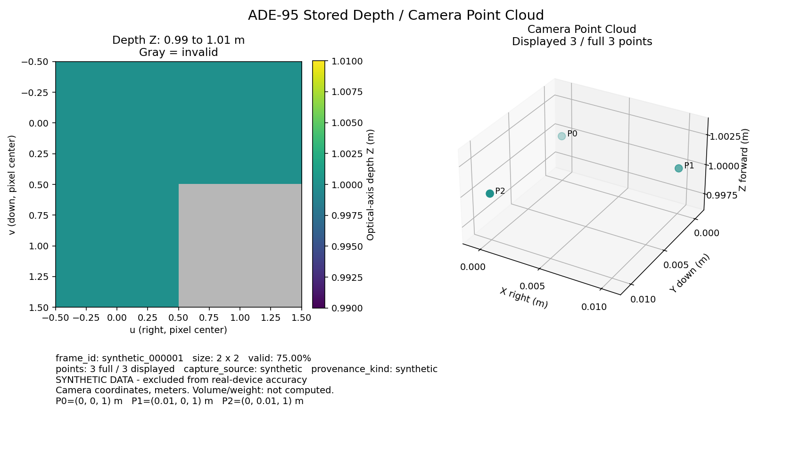
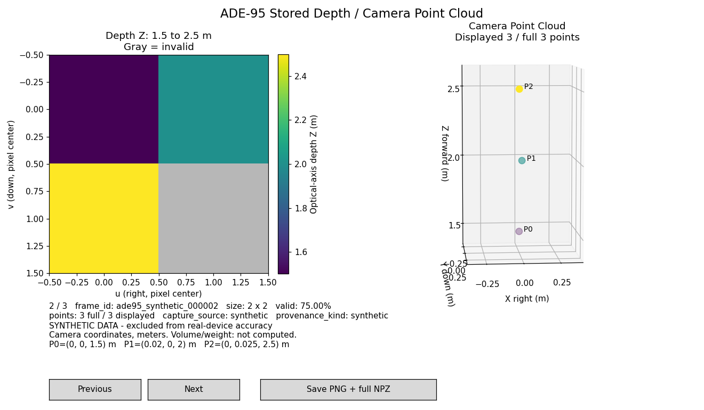

# ADE-95 저장 Depth·Point Cloud 독립 뷰어

## 설치 안내 보완 · 2026-10-11

사용자가 전달한 팀장 검토 상태에 따라 ADE-95 저장 입력 기반 구현은 검토 통과로 반영한다. 남은 설치 안내를 [README-viewer.md](../README-viewer.md)에 보완했다. 아래 2026-10-08의 Git 미설정·승인 대기·새 환경 미검증 표현과 실행 결과는 당시 기록이며 현재 상태를 뜻하지 않는다. 현재 작업은 문서 보완과 최소 실행 검증에 한정하고 데이터 계약 v1.0.0·스키마·함수·기능·의존성을 유지한다.

### 이번 최소 검증 결과

아래 결과는 2026-10-11 설치 안내 보완 단계에서 실행한 기록이다. 이후 문서 최종 검토·commit/push 단계에서 이 실행들을 반복했다는 뜻은 아니다.

실제 작업 폴더는 `C:\study\injidong_contract_v1`, remote는 `https://github.com/psy0635-ctrl/injidong-depth-viewer`, 브랜치는 `main`, HEAD는 `f9384e3e19e2dd87d6c5767ddd4ee4acd7cf216b`였다. 착수 시 Git 변경 파일은 없었고 적용되는 AGENTS.md도 없었다. 기본 런처 목록은 Python 3.14를 선택하므로 새 환경은 확인된 `py -3.11`로 생성했다.

| 검사 | 기존 .venv 재사용 | 같은 PC의 분리된 임시 새 환경 |
|---|---|---|
| Python·의존성 import | Python 3.11.9, NumPy 2.3.5, Matplotlib 3.10.8 | `py -3.11 -m venv` 생성 후 `requirements-viewer.txt` 설치 종료 0, 동일 버전 import 성공 |
| 의존성 충돌·CLI | pip check, CLI help 각각 종료 0 | pip check, CLI help 각각 종료 0 |
| Tk | tkinter import 성공, Tk/Tcl 8.6 | tkinter import 성공, Tk 8.6.12 테스트 창 생성·viewable=true·자동 닫기 종료 0 |
| 다중 프레임 예제 최소 저장 | `--frame 2 --max-display-points 2 --headless` 종료 0 | 동일 옵션 종료 0 |
| 저장 결과 입력 대조 | float32 3×3, 전체 3점·행 순서·metadata 일치, 종료 0 | 동일 결과, 종료 0 |
| GUI 자동 검사 | 기존 `scripts/check_viewer_gui.py` 1회: Tk viewable, 버튼/키 프레임 이동·저장·회전/확대 이벤트, GUI 및 CLI 자동 닫기 종료 0 | 뷰어 GUI 이벤트 검사는 반복하지 않음; Tk 테스트 창과 headless만 실행 |

수정한 두 문서의 상대 링크 21개가 모두 존재하며, PowerShell 코드 블록 16개의 구문 오류는 0개였다. 설치 입력 파일·실행 스크립트·3프레임 manifest/metadata/NPZ 존재와 명령 옵션을 실제 CLI 정의와 대조했고 `git diff --check`도 통과했다.

임시 경로는 `C:\Users\user\AppData\Local\Temp\ade95 install check 051aa8c29d6c46dc98075c5d6ccac7af`다. 공백 경로의 Python 실행은 PowerShell `&`와 따옴표로 수행했다. 새 venv·설치 로그(`fresh_install.log`)·명령별 JSON·결과·`validation_summary.json`은 이 폴더에 보존했다. 기존 `.venv`의 설치·업데이트·삭제·재생성은 수행하지 않았으며, 새 결과도 모두 임시 폴더에 저장했다. `src`·스키마·입력 예제·기존 출력·requirements 총 89개 파일의 실행 전후 SHA-256이 동일했다.

첫 결과 검증에서는 원본 규격 `README.md`에 추가한 링크 한 줄이 배포 `SHA256SUMS.txt` 보호 검사에 걸려 `PRESERVATION_MISMATCH`/종료 1이었다. 해당 추가만 되돌린 뒤 **같은 저장 결과**를 재검사하여 배포 21개 해시·스키마 5개 검사까지 종료 0으로 통과했다. 실패 로그도 `existing_verify.json`에 보존했다. 원본 README에는 독립 뷰어 안내 중복이 없으므로 그대로 유지하고, 상세 문서의 중복 설치·실행 절차를 README-viewer 링크로 연결했다. 체크섬·검증기 수정이나 코드 결함 수정은 없었다.

별도 물리 PC/깨끗한 Windows 설치, Python 3.12, 사람이 보는 테스트 창 및 직접 뷰어 조작·닫기는 이번에 검증하지 않았다. 임시 설치는 같은 PC의 기존 Python 3.11.9·Tcl/Tk 및 pip 다운로드 캐시를 사용한 새 venv 검증이며 다른 PC 성공을 뜻하지 않는다. Tk의 viewable 값과 자동 이벤트 결과는 사람의 실제 화면 확인·조작 성공과 구분한다. 전체 68개 테스트·합성 100회 재생·모바일 조사·기능 개발은 실행하지 않았다. commit/push/PR 및 Linear 업데이트도 수행하지 않았다.

## 최종 검토 보완 · 2026-10-08

뷰어 시작 안내는 [README-viewer.md](../README-viewer.md)에 추가했다. 원본 README·VALIDATION·공통 contract·스키마·배포 체크섬은 유지한다. 이번 변경은 저장 결과 검증기·회귀 테스트·문서·패키징이며 GUI·부피·중량·USB·Android 기능은 변경하지 않는다.

기존 검증기는 기본 합성 frame_id에서만 입력 좌표를 대조하여, 세 번째 점군을 전부 0으로 바꾸고 관련 해시를 갱신해도 성공했다. 수정된 검증기는 `--session`으로 명시한 입력에서 결과 frame_id를 찾아 기존 `iter_frames → load_frame → validate_frame`과 `point_cloud_camera`를 재사용한다. 전체 점군 dtype·shape·점 개수·행 순서·좌표와 전체 입력 metadata를 확인한다. 같은 float32 기준 함수의 저장·재계산 결과이므로 `numpy.array_equal`, 허용 오차 0(`rtol=0`, `atol_m=0`)을 사용한다.

`artifact_validation`은 구조·해시 검사, `input_coordinate_validation`은 실제 입력 비교다. 입력 미지정 시 기존 결과 폴더 인자는 계속 사용할 수 있지만 `not_run`·`coordinates_verified=false`로 보고한다. 과거 감사 기록의 절대 경로를 자동 입력으로 사용하지 않으며 frame_id 문자열에서 좌표를 추정하지 않는다. 명시한 입력 없음·프레임 없음·metadata 불일치·점군 불일치는 종료 1과 원인을 반환한다. 인자 오류는 종료 2다.

새 테스트는 `tests/test_verify_viewer_outputs.py`다. 이번 수정 전 실패·잘못된 점군의 거짓 성공과 수정 후 회귀 결과는 [새 검토 로그 폴더](../logs/ade95_review_fix_20261008_1791463905480000200)에 별도 기록한다. 폴더의 `previous_review`는 Temp에 남아 있던 이전 최종 검토 JSON 10개를 바이트 동일하게 복사한 과거 근거이며 이번 실행 결과가 아니다. 임시 입력·결과 복사본 전체는 제출하지 않는다.

ADE-66·67 문서가 참조하는 존재하는 과거 JSON 로그를 새 패키지에 포함한다. 존재·누락 여부는 새 로그의 `historical_logs_inventory.json`에 기록하며 누락 로그를 새로 실행하거나 꾸며 만들지 않는다. 최초 테스트 실패 로그는 과거 개발 과정으로 구분한다.

최신 배포 스키마의 버전 키는 `schema_version="1.0.0"`이다. 시각 미확보 시 시간 객체의 세 필드를 모두 null로 유지하며 객체 자체를 null로 바꾸지 않는다. 원본 요약의 `version`·`capture_time=null` 표현과 차이가 있지만 공통 스키마를 변경하지 않았다.

새 제출 ZIP은 `submissions/인지동_ADE-95_독립뷰어_검토보완_20261008.zip`으로 생성한다. 같은 이름이 있으면 고유 이름을 사용하고 기존 ZIP·체크섬을 보존한다. 패키지 내용 해시와 ZIP 해시는 각각 새로 계산한다. ZIP 생성 뒤의 최종 압축 해제 검증 기록은 순환 해시를 피하기 위해 새 검토 로그 폴더에 별도로 남긴다.

아래 환경 구축·58개 테스트·자동 GUI 검사·사용자 실행 관련 설명은 기존 작업 이력이다. 이번 수정 후 테스트와 결과 재검증은 새 검토 로그로 구분하며 기존 GUI 검사를 다시 실행하지 않는다. 사람의 직접 회전·확대·버튼·방향키와 직접 종료 코드는 여전히 미확인이다. 실제 기기·부피·중량·팀장 승인·공식 통합은 미완료다.

### 이번 수정 후 실제 실행 결과

| 검사 | 이번 결과 | 로그 |
|---|---|---|
| 수정 전 해시 일관된 잘못된 세 번째 점군 | 종료 0으로 거짓 성공 재현 | [수정 전 기록](../logs/ade95_review_fix_20261008_1791463905480000200/old_wrong_cloud_false_success.json) |
| 새 회귀 테스트 | 10개 통과, 실패 0, 종료 0 | [회귀 검사](../logs/ade95_review_fix_20261008_1791463905480000200/regression_green.json) |
| 전체 unittest | 기존 58 + 새 10 = 68개 통과, 실패 0, 종료 0, 수정 후 1회 | [전체 검사](../logs/ade95_review_fix_20261008_1791463905480000200/full_tests.json) |
| 수정 후 같은 잘못된 점군 | 파일 무결성 통과 후 POINT_CLOUD_MISMATCH, 종료 1 | [수정 후 기록](../logs/ade95_review_fix_20261008_1791463905480000200/fixed_wrong_cloud.json) |
| 사용자 원래 저장 2건과 명시한 입력 비교 | 각각 종료 0, 전체 점군·metadata 일치 | [저장 1](../logs/ade95_review_fix_20261008_1791463905480000200/user_save1.json), [저장 2](../logs/ade95_review_fix_20261008_1791463905480000200/user_save2.json) |
| 기존 환경 의존성 검사 | pip check 종료 0, 충돌 없음 | [환경 검사](../logs/ade95_review_fix_20261008_1791463905480000200/pip_check.json) |
| ADE-66·67 참조 로그 | 16개 존재, 누락 0 | [과거 로그 목록](../logs/ade95_review_fix_20261008_1791463905480000200/historical_logs_inventory.json) |

이번에 기존 환경 구축·100회 재생·자동 GUI 검사는 반복하지 않았다. 원본 사용자 저장 결과는 변경하지 않았다. 이전 Temp 검토 JSON 10개 복사본과 실제 이번 실행을 분리했다.

작성·실행 확인: 2026-10-08, Asia/Seoul. 2026-10-12 제출용 로컬 구현이다. 제출 문서 마무리에서 사용자 제공 직접 실행·저장 근거와 실제 저장 파일 검증을 추가했다. 기능·의존성 변경은 없다. 팀장 승인·공식 통합은 미완료이며 commit/push/PR, Linear/Notion 수정, 팀원 메시지는 수행하지 않았다.

## 목적과 완료 범위

카메라 없이 v1.0.0 저장 세션을 검사하고 Depth와 카메라 좌표 Point Cloud를 함께 표시한다. 프레임 이동, 프레임 정보, PNG·전체 점군 NPZ·처리 결과 JSON 저장을 지원한다. 기본 합성 예제와 별도 3프레임 예제로 독립 실행한다. 부피·중량 계산, 모델 학습, Android/USB, 실제 기기 검증과 팀 프로그램 연결은 후속 범위다.

로더·검증기·좌표 계산은 `src/contract.py`의 `iter_frames → load_frame → validate_frame`, `point_cloud_camera`를 재사용한다. 기준 코드와 함수 시그니처, 스키마, 원본 합성 샘플은 수정하지 않았다. 시작과 이동 시 세션 전체를 다시 검사한다. 대형 세션의 메모리·로드 최적화는 아직 수행하지 않았다.

## 착수 상태와 기준 자료

- 작업 폴더: `C:\study\injidong_contract_v1`. Git 미설정이며 저장소를 만들지 않았다. 상위 경로·작업 폴더의 적용 AGENTS.md는 없다.
- 기존 파일의 변경 이력은 Git이 없어 판별할 수 없다. 착수 당시 기존 파일 45개의 SHA-256을 `logs/ade95_initial_inventory.json`에 기록하고 그대로 보존했다.
- 기존 ADE-66·67 문서와 테스트, `src/replay.py`, `scripts/record_run.py`, 스키마 5개, 합성 입력·기대 좌표·배포 해시를 확인했다.
- 10/07의 42개 테스트·100회 재생은 기존 제출 기록이다. 이번에는 기존 42개 회귀와 새 뷰어 테스트 16개, 총 **58개**를 실행했다. 100회 재생·가상환경 재생성은 하지 않았다.
- 사용한 기준: `인지동_최신기준_규격v1.0.0_20261008.md`의 정정 요약과 배포 `schemas/*.schema.json`. 정리본 내 스키마 5개와 배포 스키마의 JSON 구조가 모두 일치했다.
- [규격 온라인 원문](https://linear.app/ade0033/document/%EC%9D%B8%EC%A7%80%EB%8F%99-%EA%B3%B5%ED%86%B5-%EB%8D%B0%EC%9D%B4%ED%84%B0%EC%9D%B8%ED%84%B0%ED%8E%98%EC%9D%B4%EC%8A%A4-%EA%B7%9C%EA%B2%A9-v100-a3b36c5035c8) 열기를 시도했으나 도구에서 접근하지 못했다. 온라인 이후 변경 여부는 미확인이다. 정정 내용인 `schema_version="1.0.0"`, 시간 객체의 필드별 null, 확정 필드명을 사용한다. 첨부 문서의 운영 지시는 자료로 읽었으며 외부 작업 권한으로 사용하지 않았다.

## 실제 환경·의존성

| 항목 | 이번 확인 |
|---|---|
| Python | 기존 `.venv`, 3.11.9, MSC v.1938, AMD64 |
| NumPy | 2.3.5 유지 |
| 시각화 | Matplotlib 3.10.8 신규 추가, GUI TkAgg / 비대화형 Agg |
| Tk | 기존 Python 제공 8.6.12, 실제 창 생성 확인 |
| 테스트 | 표준 unittest, pytest 추가 없음 |
| 의존성 충돌 | `pip check`: No broken requirements found |

처음 NumPy import는 DLL 로드 실패였다. 설치 RECORD에 있는 `numpy.libs/libscipy_openblas64_-9e3e5a4229c1ca39f10dc82bba9e2b2b.dll`이 실제로 없었다. 동일 NumPy 2.3.5 CPython 3.11 Windows wheel에서 누락 파일만 복원하고 설치 RECORD의 SHA-256과 대조했다. NumPy·pip를 업그레이드하거나 패키지를 강제 재설치하지 않았다. 복구 근거는 `logs/ade95_numpy_repair.json`이다. 새 `.venv`나 다른 PC는 검증하지 않았다.

최소 설치 목록은 `requirements-viewer.txt`, 실제 설치 버전 전체는 `requirements-viewer.lock.txt`다. 추가된 전이 의존성은 contourpy 1.3.3, cycler 0.12.1, fonttools 4.66.1, kiwisolver 1.5.1, packaging 26.3, pillow 12.3.0, pyparsing 3.3.3, python-dateutil 2.9.0.post0, six 1.17.0이다. 원본 `requirements.txt`는 유지했다.

## PowerShell 설치·실행 안내

현재 PC의 기존 `.venv` 재사용, 새 PC의 Python 3.11/3.12 선택·가상환경 생성·의존성 설치, Tk import/테스트 창 확인, 제공 다중 프레임 GUI·headless 실행은 [README-viewer.md](../README-viewer.md)를 따른다. 실행 안내는 해당 문서를 중심으로 유지하며 여기에는 중복 설치 명령을 두지 않는다.

아래 검증 결과와 위의 환경 구축 기록은 2026-10-08의 과거 근거다. 전체 68개 테스트·100회 재생·과거 사용자 조작 결과를 새 PC 설치 검증으로 해석하지 않는다. 이번 설치 안내 보완 결과는 문서 앞의 2026-10-11 절에 별도로 기록했다.

## 입력 구조와 표시

```text
session/
  frames.jsonl                 # 각 줄: frame_id, metadata_path
  frame_000001/
    metadata.json              # FramePacket v1.0.0
    arrays.npz                 # depth_m float32, valid_mask bool, 선택 target_mask
  frame_000002/ ...             # 다중 프레임 세션의 경우
```

`metadata_path`는 세션 상대 경로만 허용한다. 절대 경로·세션 외부 이탈과 중복 ID를 거부한다. manifest 자료형/상대 경로의 보충 검사를 제외한 규격·파일·SHA-256 검사는 기준 로더에 맡긴다. NPZ는 기준 로더의 `allow_pickle=False`를 유지한다. `labels.jsonl`은 뷰어 입력으로 읽거나 결합하지 않는다.

Depth에서 유효값은 viridis 색, 무효 픽셀은 회색이다. 범례 단위는 m이고 표시 범위를 제목에 표시한다. 범위는 프레임 유효 최소·최대다. 유효값이 모두 같으면 ±1%(최소 1e-6 m, 하한 0)의 표시 여유만 둔다. 기본 1 m 예제는 0.99~1.01 m로 표시한다. 원본 Depth·mask·메타데이터는 바꾸지 않는다.

`Previous / Next`, ←/→ 또는 P/N으로 이동한다. 처음·끝에서는 해당 경계 프레임에 머문다. 이동 시 Depth·점군·정보가 함께 갱신된다. 3D 영역 안에서 기본 왼쪽 드래그로 회전, 오른쪽 드래그로 확대/축소한다. Matplotlib toolbar의 Home으로 초기 시점 복귀가 가능하다. 운영체제 입력 장치별 직접 조작은 제출 전 확인한다. S 또는 `Save PNG + full NPZ` 버튼으로 저장한다. toolbar의 일반 Save는 입력 덮어쓰기 우회가 되지 않도록 제외했다.

기본 표시 상한은 50,000점이다. 상한을 넘으면 유효 픽셀 행 순서의 균등 인덱스를 추출하며 화면에 표시 수/전체 수를 표시한다. 계산 검증과 NPZ 저장에는 **전체** 점군을 쓴다. 점이 10개 이하면 P 번호를 표시하고 기본 3점은 좌표도 정보란에 표시한다. 단위·부호는 그대로이며 Y축의 화면 방향만 역전한다. 3D 회전과 프레임별 자동 축 범위 때문에 카메라 실제 자세로 해석하면 안 된다.

### 좌표·단위 설명 5줄

1. `depth_m[v,u]`는 광축 Z 방향 거리이며 float32, 단위는 m이다.
2. 유효 픽셀은 finite·양수이며 무효 픽셀은 0, `valid_mask=false`이다.
3. 픽셀 u는 오른쪽, v는 아래쪽이며 정수 인덱스가 픽셀 중심이다.
4. 카메라 좌표 X는 오른쪽, Y는 아래쪽, Z는 전방이고 `X=(u-cx)Z/fx`, `Y=(v-cy)Z/fy`다.
5. 실제 pose·검증된 sync 없이 world 좌표로 변환하지 않으며 부피·중량은 계산하지 않는다.

## 결과 구조와 저장 정책

GUI는 `--output` 아래에 `frame_000002_<ns>` 같은 새 폴더를 생성한다. 파일명의 ns는 출력 이름 구분용이며 입력 촬영 시각을 대체하지 않는다. Headless는 `--output` 자체를 새 결과 폴더로 생성한다. 입력 세션 내부·그 자체·기존 결과 폴더를 거부한다. 충돌 시 덮어쓰지 않는다.

| 결과 파일 | 내용 |
|---|---|
| `preview.png` | Depth/3D/정보 화면, Agg 렌더링 |
| `points.npz` | `points_m`: float32 N×3 전체 카메라 좌표, m |
| `processing.json` | 기존 ProcessingResult 스키마; stage=point_cloud, volume_m3/volume_method=null; 파일·key·SHA-256·단위·frame·point_count |
| `viewer_export.json` | 별도 뷰어 감사 기록; 입력 metadata 전체, capture_source/provenance/capture_time 보존, 표시/전체 수, 표시 범위, PNG/NPZ/processing 파일 해시 |

감사 기록은 공통 스키마 객체에 임의 필드를 추가한 것이 아니다. 감사 기록 자체의 해시는 제출 ZIP의 새 `ADE95_SHA256SUMS.txt`에서 추적한다. 입력의 pose/imu null과 각 시간 객체를 유지하고 재생 시각을 새로 삽입하지 않는다. 저장 실패 시 새로 만든 해당 결과 파일만 제거하며 불완전 결과를 성공으로 보고하지 않는다. PNG 시점은 재현 가능한 기본 시점이며 GUI에서 회전한 현재 시점 그대로를 저장하는 기능은 없다.

## 오류와 종료 정책

| 상황 | 실제 처리 / 코드 |
|---|---|
| 파일 없음·손상 JSON/UTF-8/NPZ·해시 불일치 | INPUT_CORRUPT; 기존 ContractError는 원래 code 유지 |
| 빈 세션·잘못된 manifest·중복 ID·열고 난 뒤 ID/순서 변경 | MANIFEST_INVALID |
| 절대 metadata_path·세션 이탈·입력 내부 출력·기존 결과 폴더 | PATH_INVALID |
| 스키마·버전 오류 | SCHEMA_INVALID |
| Depth dtype/shape/값 | DEPTH_DTYPE_INVALID / DEPTH_SHAPE_INVALID / DEPTH_VALUES_INVALID |
| 전체 Depth 무효 | NO_VALID_DEPTH |
| 유효 현재 프레임 없음·저장 I/O 실패 | RESULT_INVALID |

시작 실패는 창을 열지 않고 CLI 종료 1이다. 옵션 오류는 argparse 종료 2다. 이동 실패는 Depth·점군·현재 결과를 비우고 실패 프레임 번호·원인을 표시한다. 정상 프레임처럼 이전 화면을 남기지 않는다. 파일을 고친 뒤 이동해 복구할 수 있으나 해당 실행의 실패 기록은 남겨 닫을 때 종료 1을 반환한다. 저장 실패는 검사된 화면을 유지하고 저장 실패를 별도로 표시하며 역시 종료 1이다. 오류 없는 창 정상 종료는 0이다. 예상 밖 예외는 traceback을 stderr에 남기고 종료 1 또는 GUI 실패 상태를 유지한다. 성공으로 삼키지 않는다.

## 화면 예제

아래 PNG는 실행 코드에서 만든 화면이다. `tk_canvas.png`는 실제 Tk 창의 Matplotlib canvas를 저장한 이미지이며 OS 전체 스크린샷이나 사람의 조작 증거는 아니다.






위 세 번째 이미지는 사용자 저장 PNG의 바이트 동일 복사본이다. 두 사용자 저장 PNG를 직접 열어 frame_id, Depth 1~3 m 범위와 세 번째 프레임 좌표를 확인했다. 첫 프레임 화면·자동 GUI 검사 화면과 구분한다.

## 사용자 제공 실행 근거와 저장 파일 검증

사용자가 PowerShell에서 직접 실행했다고 제공한 명령:

```powershell
& .\.venv\Scripts\python.exe -X utf8 src/viewer.py examples/viewer_multiframe --output outputs/demo_gui
```

사용자 제공 관찰: 첫 프레임 `ade95_synthetic_000001`, 크기 2×2, 유효 비율 75%, 전체/표시 점 3개, 합성 데이터·카메라 좌표·m 단위, 기대 좌표 `(0,0,1)`, `(0.01,0,1)`, `(0,0.01,1)`. 세 번째 프레임 결과를 2회 저장했고 저장 후 오류 메시지 없이 PowerShell 프롬프트로 복귀했다. 어떤 버튼·키를 사용했는지와 직접 회전·확대 성공은 이 기록에서 확인하지 않는다.

원래 저장 폴더:

- `outputs/demo_gui/frame_000003_1791460557654228600`
- `outputs/demo_gui/frame_000003_1791460742554215400`

각 폴더에서 `points.npz`, `preview.png`, `processing.json`, `viewer_export.json`을 실제 확인했다. 기존 `scripts/verify_viewer_outputs.py`로 각각 검사하여 종료 0, ProcessingResult 스키마·점군 dtype/shape·출력 SHA-256·기존 배포 해시 일치를 확인했다. 검증기의 첫 프레임 기대 좌표 확인은 별도 기준 검사이므로, 추가로 `iter_frames`와 `point_cloud_camera`를 재사용해 각 저장 결과를 **다중 프레임 세션의 세 번째 프레임**과 대조했다.

두 저장 결과 모두 `frame_id=ade95_synthetic_000003`, `points_m` float32 3×3, 좌표 `[[0,0,2],[0.01,0,1],[0,0.03,3]]` m가 기준 계산과 동일하다. 표시 Depth 범위는 1~3 m, 유효 비율은 0.75이며 `volume_m3`와 `volume_method`는 null이다. 첫 프레임 좌표와 다르다. 두 저장의 네 파일은 각각 같은 SHA-256을 가지며 서로 바이트 동일하다. 이것은 동일한 세 번째 프레임을 두 번 저장한 결과이며 서로 다른 프레임 검증 횟수로 집계하지 않는다.

| 근거 구분 | 기록 |
|---|---|
| 사용자 제공 실행 근거 | `logs/ade95_user_execution_evidence.json`; 에이전트가 명령을 대신 실행한 기록과 구분 |
| 이번 저장 1 읽기 전용 검사 | `logs/1791461196407809300_ade95_user_save1_verify.json` |
| 이번 저장 2 읽기 전용 검사 | `logs/1791461196747017600_ade95_user_save2_verify.json` |
| 이번 세 번째 프레임 좌표·metadata 대조 | `logs/1791461213565276800_ade95_user_third_frame_verify.json` |
| 기존 자동 GUI 이벤트 검사 | 기존 GUI JSON/로그를 그대로 유지; 사용자 근거와 합치지 않음 |

기존 패키징 스크립트는 `--output` 옵션 하나를 사용하며 `outputs/ade95_final*`만 포함한다. 스크립트를 변경하지 않고 위 8개 파일을 `outputs/ade95_final_user_saves/` 아래 같은 저장 폴더명으로 바이트 동일 복사했다. 원본 입력과 `outputs/demo_gui`의 기존 결과는 수정하지 않았다. 복사본 해시·원래 경로는 사용자 근거 JSON에 기록했다.

재검증 명령:

```powershell
.\.venv\Scripts\python.exe -X utf8 scripts/verify_viewer_outputs.py outputs/demo_gui/frame_000003_1791460557654228600 --session examples/viewer_multiframe
.\.venv\Scripts\python.exe -X utf8 scripts/verify_viewer_outputs.py outputs/demo_gui/frame_000003_1791460742554215400 --session examples/viewer_multiframe
```

## 실제 검증 결과와 로그

| 확인 | 결과 / 근거 |
|---|---|
| 기존 회귀 | 착수 시 42개 통과, `1791459340700344800_ade95_baseline.json` |
| 구현 시 새 테스트 포함 최종 | 기존 42 + ADE-95 16 = 58개 통과, `1791459841998924200_ade95_final_tests.json`; 이번 문서·패키지 마무리에서는 전체 테스트 재실행 안 함 |
| 테스트 작성 전 실패 | 뷰어 모듈 부재 / 생성기 부재의 실패를 별도 ade95_red·generator_red 로그로 보존 |
| 기본 좌표·무효 제외 | 3점 `[[0,0,1],[.01,0,1],[0,.01,1]]`, rtol=0, atol=1e-7 m, ratio=0.75 |
| 원본/저장 | 화면 전후 배열·metadata 동일, NPZ 재로드 dtype/shape/좌표 동일, 출력 해시 일치 |
| 오류 | 임시 세션 복사본으로 JSON/NPZ/누락/해시/dtype/전체 무효/스키마/manifest/경로/저장 실패 검증; 원본 손상 없음 |
| Agg | 기본·두 번째 프레임 PNG 생성 후 이미지 내용 직접 확인 |
| Tk 실제 창 자동 검증 | 창 viewable, 버튼/키 탐색·경계, 회전·확대 변화, 저장, 정상 close 0, GUI CLI main 정상 close 0 |
| 직접 명령 실행·저장 | 사용자 제공 근거 있음: 다중 프레임 GUI 실행·세 번째 프레임 저장 2회·오류 메시지 없이 프롬프트 복귀 |
| 직접 회전·확대·버튼·방향키 | 미확인. 사용자 실행·저장 및 기존 자동 이벤트 검증과 구분 |
| 사용자 저장 파일 | 두 폴더의 기존 검증기 검사 통과; 세 번째 프레임 좌표/metadata·PNG 확인, 두 저장 파일 동일 |
| 원본 보존 | 착수 파일 45개 해시 동일; 배포 SHA256SUMS 항목 21개 동일; 정리본/배포 스키마 5개 일치 |
| 의존성 | pip check 통과, 설치/freeze 로그 포함 |

에이전트 실행의 UTF-8 로그는 `scripts/record_run.py`로 기록했다. 정상·오류 예상 테스트가 stderr에 오류 문구를 출력하는 것은 실패 사례 검증이며 구현 시 최종 unittest 결과는 58개 OK다. 기존 GUI 상세 근거는 `outputs/ade95_final_gui_cli/gui_check.json`과 해당 ade95_final_gui_cli 실행 로그다. 사용자 제공 실행 근거 JSON은 source를 별도로 표시했다. `logs/ade95_numpy_repair.json`·최초 착수 스냅샷은 복구 전 stdlib로 따로 기록한 기존 이력이며 보존했다.

## 1분 시연 대본

| 시간 | 순서와 말할 내용 |
|---|---|
| 0~10초 | 3프레임 예제로 창 열기. “카메라 없이 v1.0.0 합성 저장 세션을 읽는 ADE-95 뷰어입니다.” |
| 10~25초 | 첫 프레임: 회색 무효 픽셀, 75%, 3점, 범례 m와 P0~P2 기대 좌표 보여주기. |
| 25~40초 | Next/Previous로 두 번째 프레임의 색·점군·ID 동시 갱신, 3D 드래그 회전/확대 보여주기. |
| 40~50초 | S로 저장. PNG, 전체 points_m NPZ, point_cloud 처리 JSON의 null 부피 설명. |
| 50~60초 | 닫기 후 없는 세션 명령으로 INPUT_CORRUPT·종료 1 확인. “실제 기기/부피/중량은 후속이며 로컬 합성 구현 완료입니다.” |

시연 오류 명령(실제로 종료 1을 확인한 종류):

```powershell
.\.venv\Scripts\python.exe -X utf8 src/viewer.py examples/not_present --headless --output outputs/unused_error
$LASTEXITCODE
```

## 이전 제출 ZIP 기록과 남은 작업

이전 최종 제출물은 `submissions/인지동_ADE-95_독립뷰어_최종제출_20261008.zip`이며 그대로 보존한다. 이번 검토 보완 제출물은 위의 새 ZIP이다. 이전 제출물은 코드·스키마·의존성·문서·예제·기존 자동 검사 기록·사용자 실행 근거·저장 결과 복사본·검증 로그를 포함했다. 새 ZIP에도 `.venv`, `__pycache__`, `*.pyc`, 임시 파일, 기존 제출 ZIP은 넣지 않는다. 원본 `SHA256SUMS.txt`와 새 `ADE95_SHA256SUMS.txt`를 구분하며 새 ZIP SHA-256은 외부 `.zip.sha256`에 기록한다.

기존 `submissions/인지동_ADE-95_독립뷰어_20261008.zip`과 체크섬 파일은 보존한다. 기존 ZIP SHA-256 `2c95cda0ffb753e869486d7d9fbc2372deda2f2d68667f35bbdcfa2cab0d947f`는 기존 제출물의 값이며 새 ZIP 값으로 재사용하지 않는다.

재패키징은 새 이름으로 수행한다:

```powershell
.\.venv\Scripts\python.exe -X utf8 scripts/package_ade95.py --output "submissions/ade95_$ade95Run.zip"
Get-FileHash -Algorithm SHA256 submissions/인지동_ADE-95_독립뷰어_최종제출_20261008.zip
```

남은 작업: 직접 회전·확대·버튼·방향키 조작과 창 닫기 방법/종료 코드 확인, 온라인 규격 변경 확인. 직접 명령 실행·저장은 사용자 근거가 있고 오류 메시지 없이 프롬프트 복귀는 보고됐다. 실제 기기 검증·부피/중량 구현 및 검증·팀장 승인·공식 통합은 미완료다. 대형 실측 세션의 처리 시간·메모리·창 반응성, 다른 PC/DPI와 입력 장치는 미검증이다. ADE-95 로컬 구현 완료와 팀장 승인·공식 통합을 구분한다.
